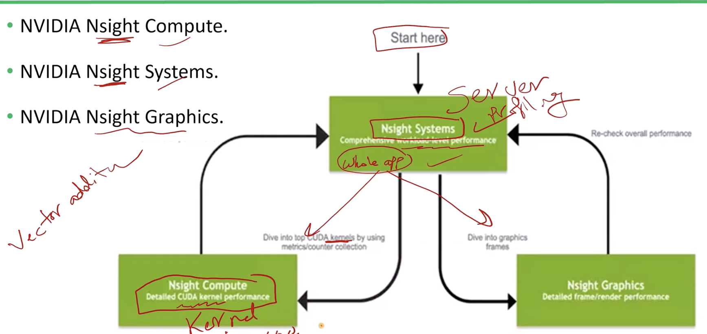

# 第 27 章 NVIDIA 全系性能分析工具

## NVIDIA全系性能分析工具（Nsight Systems/Compute 与 Compute Sanitizer）

本章系统介绍 NVIDIA 为 CUDA 应用程序提供的分析与剖析工具。需要特别说明的是，`nvprof` 分析工具在许多早期教程中被广泛使用，但现已被弃用，其功能由 Nsight Compute 取代，因此本章不再详述。此外，早期工具 **CUDA-MEMCHECK** 也已被 **NVIDIA Compute Sanitizer** 所取代。

## CUDA-MEMCHECK 与 Compute Sanitizer

### 工具定位

CUDA-MEMCHECK 曾是用于识别和诊断 CUDA 应用程序内存错误的工具，可以检测越界访问、未对齐的内存访问等错误，其作用与调试工具 cuda-gdb 互补。对于确保 CUDA 应用程序的正确性至关重要，而正确性又直接影响程序的性能表现。

随着 CUDA 工具包的发展，CUDA-MEMCHECK 已演变为 **NVIDIA Compute Sanitizer**——一套功能正确性检查工具集，随 CUDA Toolkit 一并发布。它包含四个子工具：

| 子工具 | 功能 |
| --- | --- |
| `memcheck` | 运行时错误检测：精确检测全局内存、局部内存与共享内存的越界访问、未对齐访问、硬件错误信息及内存泄漏 |
| `racecheck` | 共享内存数据竞争检测：识别使用 `__shared__` 声明的共享内存中的数据竞争（Data Race）隐患 |
| `initcheck` | 未初始化内存检测：识别未经设备端写入或 `cudaMemcpy`/`cudaMemset` 初始化就被访问的设备全局内存 |
| `synccheck` | 同步原语检测：验证 `__syncthreads()`、`__syncwarp()` 及 Cooperative Groups API 的同步使用是否正确 |

其中 `racecheck` 工具与本书第 40 章讨论的竞态条件主题直接相关：共享内存被块内所有线程共享，多线程并行访问时极易产生数据竞争，`racecheck` 正是定位此类问题的专用工具。

## NVIDIA Visual Profiler（NVVP）

NVIDIA Visual Profiler（简称 NVVP）是一个跨平台的性能分析工具，支持 CUDA、OpenCL、Direct3D 和 OpenGL 应用程序，并提供硬件计数器采集功能。正如其名称中的 "Visual" 所示，该工具的主要特点是可视化：提供应用程序时间线（Timeline）与实际占用率（Achieved Occupancy）的图形化视图，帮助开发者识别 GPU 核函数与内存传输中的性能瓶颈。

需要注意的是，随着 Nsight 套件的完善，Visual Profiler 已进入维护状态，新项目建议直接使用 Nsight Compute 与 Nsight Systems。

## Nsight 套件三大工具

*图 1 Nsight 套件三大工具的分工层次：从 Nsight Systems（整体应用分析）出发，深入至 Nsight Compute（核函数级性能）与 Nsight Graphics（图形帧/渲染性能）*

本章重点介绍 Nsight 套件中三个最重要的工具：**Nsight Systems**、**Nsight Compute** 与 **Nsight Graphics**。图 [图 1](#fig-fig:nsight-hierarchy) 解释了三个工具之间的层次关系：以 Nsight Systems 为起点，将应用程序作为**整体**进行系统级检查；随后根据负载类型分流，Nsight Compute 深入**单个核函数**的微观性能，Nsight Graphics 则深入**单帧图形**的渲染性能。

### Nsight Systems：系统级分析

当一个应用程序包含多个核函数时，仅仅分析单个核函数是不够的，需要从全局视角定位瓶颈。Nsight Systems 正是为此设计：它是**系统级**（system-wide）性能分析工具，可以可视化 CPU 与 GPU 之间的交互、CUDA Runtime API 的调用开销、内存传输与核函数执行的时间重叠情况，甚至可以分析多进程、多节点的工作负载。

因此可以认为，Nsight Systems 是一种"服务器端"的分析工具，而非仅仅针对单个客户端的工具。本书在前文分析向量加法应用程序时使用的正是该工具。官方文档参见 [Nsight Systems 产品页](https://developer.nvidia.com/nsight-systems)与 [Nsight Systems 文档](https://docs.nvidia.com/nsight-systems/)。

### Nsight Compute：核函数级深入分析

当需要深入剖析每个核函数时，Nsight Compute 是首选工具。它提供了超过 10 万个针对单个核函数的详细度量指标，覆盖全局内存、缓存、SM 乃至 SM 内部每个独立执行单元，并支持将度量结果关联到 SASS 汇编与源码行（Source Correlation）。

Nsight Compute 的核心特性包括：

- **引导式分析（Guided Analysis）**：内置 NVIDIA 工程师总结的性能规则集，自动标记低 GPU 吞吐量并检测性能限制因素（Performance Limiter），给出优化建议。
- **内存工作负载分析**：以热力图可视化内存管线的传输量与利用率，帮助直观定位内存瓶颈。
- **源码关联**：将效率指标下钻到具体的源码行，同时连接 SASS 汇编、PTX 与高层语言（CUDA C/C++、Fortran、OpenACC 等）。
- **CUDA Graph 可视化**：交互式分析会话支持查看 CUDA Graph 的节点连接关系，并可单独分析图中任一节点。
- **基线对比（Baseline Comparison）**：对比不同 GPU 架构或不同版本代码的性能差异，结果可直接在报告页中查看。

官方文档参见 [Nsight Compute 产品页](https://developer.nvidia.com/nsight-compute)与 [Nsight Compute 文档](https://docs.nvidia.com/nsight-compute/)。

### Nsight Graphics：图形应用专业工具

Nsight Graphics 面向图形应用程序，支持 Direct3D、Vulkan、OpenGL 与 OpenXR，提供帧调试（Frame Debugging）、GPU Trace 性能追踪与光线追踪调试能力：

- **GPU Trace**：以极低开销捕获完整时间线，自动分析性能阻塞点，深入 SM 着色器执行追踪。
- **光线追踪调试**：Ray Tracing Inspector 可检查加速结构（Acceleration Structure）、优化 AABB 与构建标志，评估光线遍历效率。
- **着色器调试与分析**：Vulkan Shader Debugger 支持实时调试着色器源码；着色器计时热力图可视化逐像素的性能热点。

官方文档参见 [Nsight Graphics 产品页](https://developer.nvidia.com/nsight-graphics)与 [Nsight Graphics 文档](https://docs.nvidia.com/nsight-graphics/)。

## 工具选型指南

面对不同场景，工具的选择策略可归纳如下：

| 分析目标 | 推荐工具 |
| --- | --- |
| 定位整个应用的瓶颈（多核函数、CPU-GPU 交互、多进程） | Nsight Systems |
| 剖析单个核函数的性能指标与优化空间 | Nsight Compute |
| 检测内存越界、泄漏、数据竞争与同步错误 | Compute Sanitizer（memcheck / racecheck / initcheck / synccheck） |
| 调试与优化图形渲染管线、光线追踪性能 | Nsight Graphics |
| CUDA 程序交互式调试（断点、单步、变量检查） | cuda-gdb（Linux）/ Nsight Visual Studio Edition（Windows） |

## 本章小结

- NVIDIA 分析工具分为系统级（Nsight Systems）、核函数级（Nsight Compute）与图形级（Nsight Graphics）三个层次，各司其职。
- 早期工具 `nvprof` 已弃用，CUDA-MEMCHECK 已演变为 Compute Sanitizer 工具集。
- 本课程后续章节的性能分析将完全围绕 Nsight Compute 展开，必要时辅以 Nsight Systems。
- 正确性是性能的前提：在优化之前，建议先使用 Compute Sanitizer 排除内存与竞态错误。
