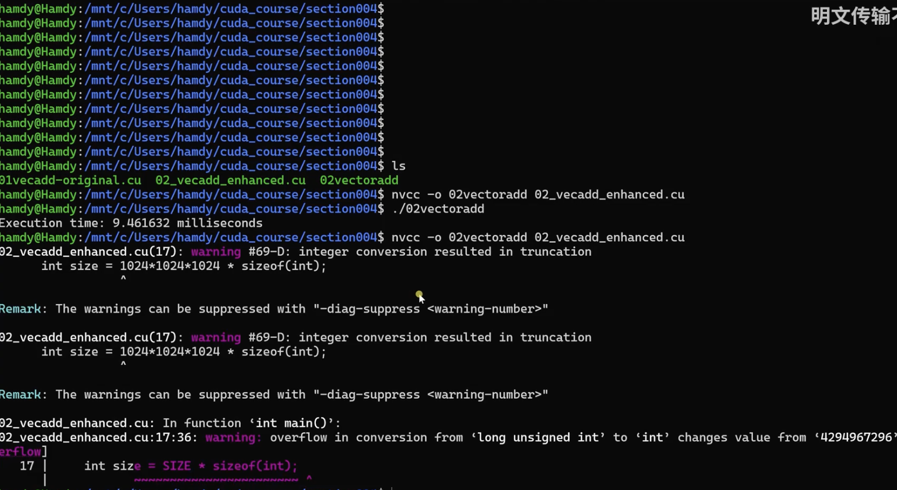
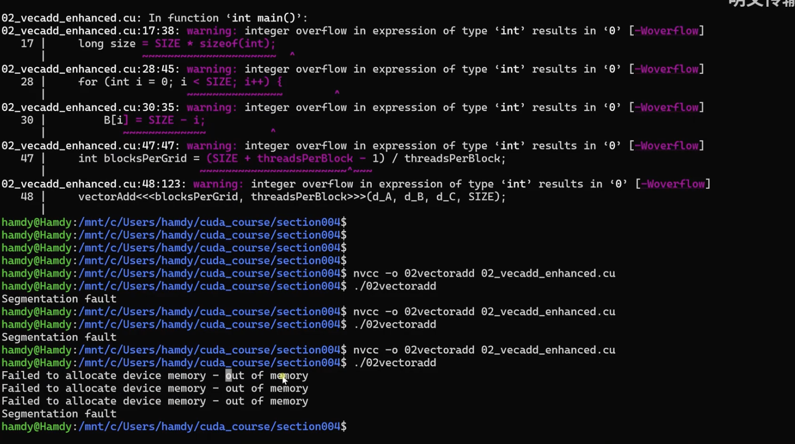

# 第 28 章 错误检查 API 详解

## 错误检查API详解

在深入使用 Nsight Compute 分析 CUDA 应用之前，必须强调错误检查的重要性。一个常见的误区是：应用程序编译时没有任何错误，就认为它可以正确执行。实际上，很多错误在编译期无法被检测到——例如内存分配失败（RAM 或显存不足）——它们只会在运行时以段错误（Segmentation Fault）或无输出的形式表现出来。正因如此，为每一个 CUDA 函数调用加上错误检查，是写出健壮 CUDA 程序的基本功。

## 错误码与核心错误处理 API

CUDA Runtime API 使用 `cudaError_t` 枚举类型表示函数执行结果。大多数 Runtime API 函数都返回一个 `cudaError_t` 值，其中 `cudaSuccess`（值为 0）表示执行成功，其余枚举值对应各类错误。

CUDA Runtime 提供了四个核心错误处理 API，官方定义于 [CUDA Runtime API Reference Manual 的 Error Handling 章节](https://docs.nvidia.com/cuda/cuda-runtime-api/group__CUDART__ERROR.html)：

| API | 功能 |
| --- | --- |
| `cudaGetErrorName(error)` | 返回错误码对应的枚举名（如 `cudaErrorMemoryAllocation`），无法识别时返回 `"unrecognized error code"` |
| `cudaGetErrorString(error)` | 返回错误码对应的可读描述（如 `"out of memory"`），适合直接打印给用户 |
| `cudaGetLastError()` | 返回本主机线程中最近一次运行时调用产生的错误，**并将错误重置为 cudaSuccess** |
| `cudaPeekAtLastError()` | 返回最近一次运行时调用产生的错误，**但不重置**错误状态 |

两个查询函数的分工很明确：`cudaGetErrorName` 适合写入日志、便于检索与分类，`cudaGetErrorString` 适合直接展示给用户阅读。而 `cudaGetLastError` 与 `cudaPeekAtLastError` 的区别在于是否**清空**错误状态——后者只"偷看"而不清除，适合在需要多次检查同一错误的场景使用。官方文档特别提示：这两个函数都可能返回**之前异步启动**的核函数产生的错误码。

## 同步错误检查

CUDA 操作可以大致分为同步与异步两类，错误检查方式随之不同。

像 `cudaMalloc` 这样的操作是**同步**的：调用会阻塞主机代码，直到设备完成操作后才返回，因此返回值本身就是本次操作的错误码，检查方式非常直接——在函数返回后立即检查错误码即可：

```cpp
#include <stdio.h>
#include <cuda_runtime.h>

int main() {
    const int N = 32;
    size_t bytes = N * sizeof(int);

    int *d_a;
    cudaError_t err = cudaMalloc(&d_a, bytes);
    if (err != cudaSuccess) {
        fprintf(stderr, "cudaMalloc failed: %s (%s)\n",
                cudaGetErrorString(err), cudaGetErrorName(err));
        return 1;
    }

    cudaFree(d_a);
    return 0;
}
```

这段代码声明一个 `cudaError_t` 对象存储函数的返回值，检查它是否等于 `cudaSuccess`，失败时通过 `cudaGetErrorString` 与 `cudaGetErrorName` 打印可读的错误信息。`cudaMemcpy`、`cudaEventRecord`、`cudaFree` 等同步 API 都应采用相同的模式。

## 异步错误检查

核函数启动与同步操作不同：`<<< >>>` 启动语法**不返回错误码**，且主机代码不会等待核函数执行完成，而是继续执行下一条指令。如果不调用 `cudaDeviceSynchronize`，随后的 `cudaMemcpy` 可能在核函数执行完成之前就尝试复制结果，得到未定义的行为。

异步操作的错误会被记录在 CUDA Runtime 的状态中，需要主动查询。标准做法是：核函数启动之后立即用 `cudaGetLastError` 检查**启动配置类**错误（如网格维度非法、核函数不存在），同步之后再次检查**执行期**错误：

```cpp
// 启动核函数（此调用本身不返回错误码）
vector_add<<<grid, block>>>(d_a, d_b, d_c, N);

// 1. 立即检查启动配置类错误
cudaError_t err = cudaGetLastError();
if (err != cudaSuccess) {
    fprintf(stderr, "Kernel launch failed: %s\n",
            cudaGetErrorString(err));
    return 1;
}

// 2. 同步后检查执行期错误
cudaDeviceSynchronize();
err = cudaGetLastError();
if (err != cudaSuccess) {
    fprintf(stderr, "Kernel execution failed: %s\n",
            cudaGetErrorString(err));
    return 1;
}
```

这里有一个容易忽略的细节：`cudaGetLastError` 在读取后会**重置**错误状态。如果在同步之前已经调用过它，同步之后就会得到 `cudaSuccess`，掩盖掉真正的执行期错误。若希望在不清除状态的情况下先查看错误，应使用 `cudaPeekAtLastError`。

## 实战案例：内存不足与整数溢出

下面用一个真实场景说明错误检查如何定位问题。将向量加法的元素数量从 32 提升到 1024 × 1024 × 1024（每个向量约 4 GB，三个向量合计约 12 GB）。首次编译时出现警告：

<a id="fig-ch28-1"></a>



第 17 行定义的 `int size` 需要存储元素数与 4 字节的乘积，而乘积 2<sup>32</sup> 恰好超出 `int` 的表示范围，发生整数截断（truncation）。修复方法是将类型改为 64 位的 `long`。然而仅改类型并不足够：

<a id="fig-ch28-2"></a>



警告信息 "integer overflow in expression of type 'int'" 表明，`1024*1024*1024*sizeof(int)` 中所有操作数都是 `int`，乘法在存入 `size` **之前**就按 32 位计算并溢出。正确写法是在字面量后追加 `LL` 后缀，让乘法按 `long long` 类型进行：

```cpp
long long size = 1024LL * 1024LL * 1024LL * sizeof(int);
```

继续将规模乘以 20（每个向量约 80 GB，三个向量约 240 GB）后运行程序，出现段错误。此时主机端 `malloc` 与设备端 `cudaMalloc` 都有可能失败，但程序没有任何可读的报错信息——这正是缺少错误检查的后果。

为三个 `cudaMalloc` 调用添加错误检查后重新运行，输出依然只是段错误。原因在于：主机端 `malloc` 先于 `cudaMalloc` 执行并首先失败，而 `malloc` 没有经过任何错误检查。把设备端分配**前移**到主机端分配之前后，`cudaMalloc` 首先尝试分配 80 GB 显存：它先耗尽全部 24 GB 专用 GPU 内存，再尝试使用共享内存，最终失败并输出 "GPUAssert: out of memory"——错误检查成功地把问题精确定位到了第一个失败的分配调用上。

这个案例说明两点：其一，分配失败类的错误编译期无法察觉，只能依靠运行时错误检查；其二，错误检查的顺序应与资源分配的依赖顺序一致，否则最先失败的操作会把报错机会留给未受检查的代码。

## 错误检查宏封装

逐行重复"声明错误对象、调用、比较、打印"三条指令会使代码冗长不堪。对于每个 CUDA 函数都执行错误检查的应用程序，这些指令会出现十几次甚至几十次。合理的做法是把它们封装成宏：

```cpp
#include <stdio.h>
#include <stdlib.h>
#include <cuda_runtime.h>

// 错误检查函数：检查错误码，失败则打印并退出
__host__ inline void cudaAssert(cudaError_t code,
                                const char *file, int line) {
    if (code != cudaSuccess) {
        fprintf(stderr, "GPUAssert: %s (%s) %s:%d\n",
                cudaGetErrorString(code),
                cudaGetErrorName(code),
                file, line);
        exit(code);
    }
}

// 同步操作：传入函数返回值
#define CUDA_CHECK_ERROR(val) \
    cudaAssert((val), __FILE__, __LINE__)

// 异步操作：核函数启动后查询最近错误
#define CUDA_CHECK_KERNEL() \
    cudaAssert(cudaGetLastError(), __FILE__, __LINE__)

int main() {
    const int N = 32;
    size_t bytes = N * sizeof(int);

    int *h_a, *h_b, *h_c, *d_a, *d_b, *d_c;
    h_a = (int *)malloc(bytes);
    h_b = (int *)malloc(bytes);
    h_c = (int *)malloc(bytes);

    CUDA_CHECK_ERROR(cudaMalloc(&d_a, bytes));
    CUDA_CHECK_ERROR(cudaMalloc(&d_b, bytes));
    CUDA_CHECK_ERROR(cudaMalloc(&d_c, bytes));

    CUDA_CHECK_ERROR(cudaMemcpy(d_a, h_a, bytes,
                                cudaMemcpyHostToDevice));
    CUDA_CHECK_ERROR(cudaMemcpy(d_b, h_b, bytes,
                                cudaMemcpyHostToDevice));

    vector_add<<<1, N>>>(d_a, d_b, d_c, N);
    CUDA_CHECK_KERNEL();
    CUDA_CHECK_ERROR(cudaDeviceSynchronize());

    CUDA_CHECK_ERROR(cudaMemcpy(h_c, d_c, bytes,
                                cudaMemcpyDeviceToHost));

    CUDA_CHECK_ERROR(cudaFree(d_a));
    CUDA_CHECK_ERROR(cudaFree(d_b));
    CUDA_CHECK_ERROR(cudaFree(d_c));

    free(h_a); free(h_b); free(h_c);
    return 0;
}
```

宏的要点如下：

- `CUDA_CHECK_ERROR` 直接展开为对 `cudaAssert` 的调用，将函数返回值、文件名（`__FILE__`）与行号（`__LINE__`）一并传入，失败输出形如 `GPUAssert: out of memory (cudaErrorMemoryAllocation) 02_vecadd_enhanced.cu:37` 的信息。
- `cudaAssert` 声明为 `__host__ inline`：`inline` 表示指令会在调用处内联展开，不引入额外的函数调用开销；`__host__` 指明它运行在主机端。
- 失败后调用 `exit` 直接终止程序。既然内存分配已经失败，继续执行后续指令毫无意义，立即退出可以避免级联错误和难以解读的输出。
- 异步核函数启动没有返回值，因此提供独立的 `CUDA_CHECK_KERNEL` 宏，在启动语句之后调用 `cudaGetLastError` 检查最近错误。

## 常见错误码速查

日常开发中经常遇到的错误码如下（完整列表见 CUDA 头文件 `driver_types.h` 与官方文档）：

| 错误码 | 含义 |
| --- | --- |
| `cudaSuccess`（0） | 执行成功 |
| `cudaErrorMemoryAllocation` | 设备端内存分配失败（out of memory） |
| `cudaErrorInvalidValue` | 传入参数值无效 |
| `cudaErrorInvalidDevicePointer` | 使用了无效的设备指针 |
| `cudaErrorInvalidConfiguration` | 核函数启动配置非法（网格/块维度超限） |
| `cudaErrorLaunchFailure` | 核函数启动或执行失败 |
| `cudaErrorIllegalAddress` | 核函数访问了非法内存地址（越界） |
| `cudaErrorNoDevice` | 未检测到可用的 CUDA 设备 |

其中 `cudaErrorIllegalAddress` 在调试阶段尤其常见，它通常意味着核函数中的数组访问越界，配合错误检查可以快速锁定出错的核函数。

## 本章小结

- 编译通过不代表运行正确，内存分配失败等错误只能在运行时暴露，必须为每个 CUDA 调用添加错误检查。
- 同步操作直接检查返回值；异步操作在启动后与同步后分别用 `cudaGetLastError` 检查，注意其**重置**语义与 `cudaPeekAtLastError` 的区别。
- `cudaGetErrorString` 与 `cudaGetErrorName` 将错误码转换为可读文本，是错误输出的标准组合。
- 通过 `CUDA_CHECK_ERROR` / `CUDA_CHECK_KERNEL` 宏封装可消除重复代码，失败时打印文件名与行号并立即退出。
- 后续章节的所有示例代码都将采用这套错误检查模式，不再重复解释。
