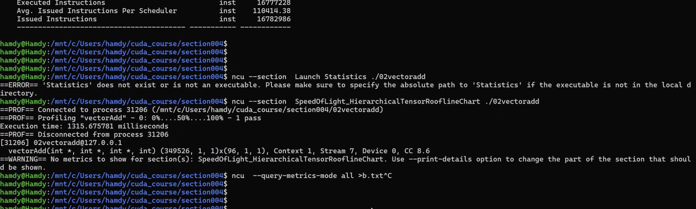
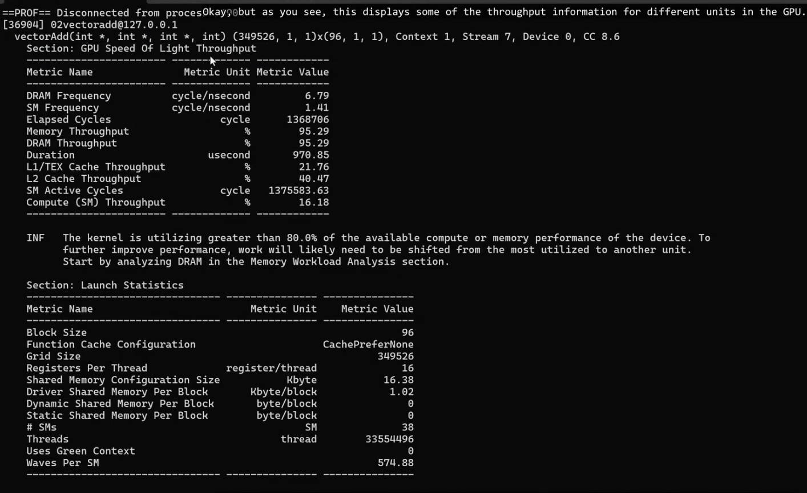
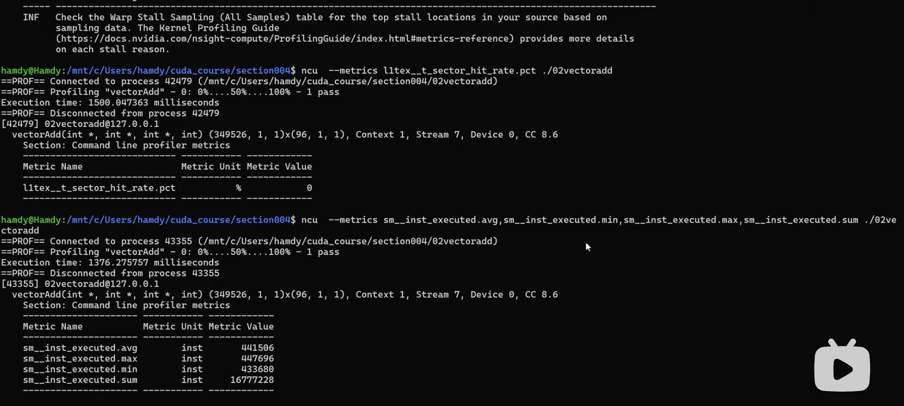

# 第 29 章 命令行 Nsight Compute

## 命令行模式下的 Nsight Compute 性能分析

本章介绍如何使用 **Nsight Compute** 的命令行工具 `ncu` 分析 CUDA 应用程序。任何成熟的性能分析工具都应提供两种分析方式：

1. **命令行分析（CLI Profiling）**：通过命令收集特定指标，快速评估 CUDA 应用程序的性能，适合自动化与脚本化场景。
2. **图形界面分析（GUI Profiling）**：提供屋顶线分析（Roofline Analysis）、图表与每个硬件单元的利用率等深度信息，适合深入诊断。GUI 分析将在后续章节讲解。

当只需收集少数指标评估某个硬件单元时，命令行分析是首选；当需要全面深入的性能评估时，再转向 GUI。本章从命令行分析讲起。

## ncu 命令与基础用法

`ncu` 是 Nsight Compute CLI 的可执行文件，随 CUDA Toolkit 一并发布（Linux 默认路径 `/usr/local/cuda-<ver>/NsightCompute-<ver>`）。它以非交互方式启动目标应用程序，插桩拦截 CUDA API，对指定核函数收集指标，并将结果打印到终端或写入报告文件。官方文档见 [Nsight Compute CLI User Guide](https://docs.nvidia.com/nsight-compute/NsightComputeCli/index.html)。

最基础的用法是为应用程序中所有核函数启动收集默认指标集合：

```bash
ncu -o profile ./my_cuda_app
```

应用程序以插桩模式运行，每个核函数启动都会生成一份分析结果，默认写入 `profile.ncu-rep` 报告文件。工具输出以 `==PROF==` 开头的行是分析器自身的信息，其余行是应用程序自身的输出。由于完整采集所有指标可能需要多次重放（replay）核函数，每次分析结束时会显示该核函数的总重放次数（pass 数）。一个典型的运行片段如下：

```text
==PROF== Connected to process 5268
CUDA kernel launch A with 4471 blocks of 256 threads
==PROF== Profiling "vectorAdd_A" - 0: 0%....50%....100% - 46 passes
==PROF== Disconnected from process 5268
==PROF== Report: profile.ncu-rep
```

## 分段（Sections）与集合（Sets）

Nsight Compute 将分析数据组织为不同的"分段"（Section），每个分段对应一组逻辑上相关的指标，用于回答某个具体的性能问题。分段通过 `--set` 与 `--section` 选项控制：

- `--set basic`（默认）：收集基础分段集合，覆盖最常见的性能问题。
- `--set full`：收集全部分段，指标最全但重放次数多、耗时长。
- `--list-sets` / `--list-sections`：列出当前可用的集合与分段及其标识符。
- `--section <ID>`：按标识符精确指定要收集的分段，可多次使用。

默认 basic 集合包含四个分段：

| 分段 | 内容 |
| --- | --- |
| GPU Speed Of Light Throughput | GPU 各单元（DRAM、L1/TEX、L2、SM）的吞吐量与频率 |
| Launch Statistics | DRAM/L1/L2 吞吐量、SM 利用率等启动级统计 |
| Occupancy | 块大小、网格大小、每线程寄存器数、每 SM 共享内存、理论与实际占用率 |
| GPU and Memory Workload Distribution | 各硬件单元的活跃周期与工作负载分布 |

Nsight Compute 实际提供约 23 个分段（标识符从 4 到 27），还包括 NVLink 通信统计、调度器统计（Scheduler Stats）、线程束状态统计（Warp State Stats）、停顿原因采样（Warp Stall Sampling）等。命令行中需使用分段的标识符而非显示名称，例如只查看启动统计：

```bash
ncu --section LaunchStats ./my_cuda_app
```

<a id="fig-ch29-1"></a>



运行默认 basic 集合后，终端会按分段输出三列表格（指标名、单位、数值）。图 [图 2](#fig-fig:ch29-sol-output) 展示了 SpeedOfLight Throughput 分段的典型输出，包含 DRAM 频率、SM 频率、已用周期数、各单元吞吐量等关键指标：

<a id="fig-fig:ch29-sol-output"></a>



## 分析建议与警告

Nsight Compute 在输出中会附带建议或警告。例如提示"可选指标无法找到"，通常是因为当前 GPU 架构不支持该指标；又如停顿原因分析会指出"平均而言，此核函数的每个线程束因等待记分牌依赖（Scoreboard Dependency）而停顿了 111 个周期"。判断瓶颈严重程度时，需将该停顿周期数与总周期数对比，而非孤立看待。

## 指标（Metrics）与命名结构

Nsight Compute 内置约 10 万个指标。为高效使用，必须掌握其命名规则。多数指标名遵循"基名 + 后缀"的结构，例如 `sm__throughput.avg.pct_of_peak_sustained_elapsed`，基名为 `sm__throughput`，后缀为 `.avg.pct_of_peak_sustained_elapsed`。基名进一步分解为：

`<硬件单元>__<指标描述>.<聚合方式>`

## 硬件单元前缀

双下划线之前的部分定义被分析的硬件单元：

- `dram`：设备内存（DRAM）
- `l1tex`：L1/纹理缓存
- `lts`：L2 缓存（Level Two Slice）
- `sm`：SM（Streaming Multiprocessor）
- `smsp`：SM 内每个处理块（per-SM-Partition）
- `gpu`：整个 GPU

## 聚合方式后缀

点号之后的标识符表示数据的聚合方式：

- `.min`：所有 SM 中的最小值
- `.max`：所有 SM 中的最大值
- `.avg`：所有 SM 的平均值
- `.sum`：整个 GPU 的总和

**重要技巧：** `.sum` 是基于最大值计算的，而非平均值，即 Sum = Max × SM\_Count。如果在命令行中省略点号及后缀（例如只写 `smsp__inst_executed`），工具将自动收集该指标的所有聚合类型（avg、max、min、sum）。若想查看某个指标的所有完整名称（含后缀），可用 `--query-metrics-mode suffix`。

## 常用指标示例

- **L1 缓存命中率**：`l1tex__hit_rate`（或 sector 级 `l1tex__t_sector_hit_rate.pct`）
- **DRAM 访问字节数**：`dram__bytes.sum`
- **扇区数量**：NVIDIA GPU 中每个扇区（Sector）为 32 字节，相关指标如 `dram__sectors.read.sum`
- **指令执行数**：`smsp__inst_executed.avg`（SM 内执行的平均指令数）
- **管道利用率**：可搜索 `pipe__lsu`（加载存储单元）、`pipe__tensor`（张量核心）、`fp16` / `fp64` 等
- **SM 吞吐量**：`sm__throughput.avg.pct_of_peak_sustained_elapsed`（占峰值吞吐量的百分比）

## 收集特定指标

使用 `--metrics` 参数可收集指定指标。先用 `--query-metrics` 查询目标应用支持的可用指标，再用 `--metrics` 选取：

```bash
ncu --metrics l1tex__hit_rate,smsp__inst_executed ./02_vector_add
```

<a id="fig-fig:ch29-metrics-cmd"></a>



如图 [图 3](#fig-fig:ch29-metrics-cmd) 所示，若 L1 命中率为 0%，说明所有内存操作都访问了全局内存，这是严重的性能瓶颈，需要优化数据局部性（如使用共享内存分块）。同一指标的不同聚合方式可一次指定：

```bash
ncu --metrics sm__inst_executed.avg,sm__inst_executed.min,\
sm__inst_executed.max,sm__inst_executed.sum ./02_vector_add
```

## 使用正则表达式过滤

若要分析特定硬件单元的所有指标，可使用正则表达式匹配：

```bash
ncu --metrics ".*shared.*" ./02_vector_add
```

这将筛选出所有名称中包含 "shared" 的指标（即共享内存相关指标）。注意正则表达式需用引号包裹，避免 shell 解释通配符。

## 核函数过滤与重放机制

当应用程序包含大量核函数启动时，逐一分析既慢又冗余。ncu 提供多种过滤选项：

- `-k` / `--kernel-name <regex>`：按核函数名的正则匹配过滤。
- `-c` / `--launch-count <n>`：限制收集的核函数启动次数。
- `-s` / `--launch-skip <n>`：跳过前若干次核函数启动后再开始收集。
- `--kernel-id <context,stream,name,invocation>`：按上下文、流、名称与调用序号精确过滤。
- `--nvtx --nvtx-include <range>` / `--nvtx-exclude <range>`：基于 NVTX 标注范围过滤，只分析标注区间内的核函数。

示例：只分析名称匹配 `matmul` 的前 3 次启动：

```bash
ncu -k "matmul.*" -c 3 ./my_app
```

Nsight Compute 采集指标时采用**重放**（replay）机制。由于硬件性能计数器数量有限，无法在一次核函数执行中同时采集所有指标，工具会多次重放同一核函数，每次采集一部分指标，最后合并。重放模式由 `--replay-mode` 控制：

- `kernel`（默认）：在应用程序执行过程中"透明"地重放单个核函数启动，适合多数场景。
- `app`：以应用程序为单位重放，整个程序从头运行多次，适合核函数依赖前序状态的场景。
- `context`：在 CUDA 上下文边界内重放。

重放次数取决于请求的指标数量与硬件计数器容量，命令输出中的 "46 passes" 即表示该核函数被重放了 46 次。指标越多、重放越多、分析耗时越长，这正是 `--set full` 比 `--set basic` 慢得多的原因。

## 输出页面与结果导出

ncu 支持以不同"页面"（page）格式化终端输出，每种页面对应 GUI 报告中的一个视图，由 `--page` 选项选择：

- `details`（默认）：对应 Details 页，按分段输出三列表格，并附带规则（Rule）的优化建议。
- `raw`：对应 Raw 页，输出所有采集到的原始指标，包括设备属性与启动信息等自动采集项。
- `source`：对应 Source 页，将指标关联到源码行。

将结果导出为 CSV 便于在 Excel 或脚本中后续处理：

```bash
ncu --metrics smsp__inst_executed --csv --log-file result.csv ./app
```

已采集的报告可用 `--import` 导入 ncu 重新过滤分析，配合 `--export` 可从一份报告导出筛选后的子集到另一份报告，便于团队共享与二次分析。

## 多进程与 MPI 支持

ncu 支持多进程应用程序分析，对 MPI 场景尤其重要。使用 `--target-processes all` 可分析同一节点上所有进程的核函数：

```bash
ncu --target-processes all -o profile mpirun [mpi参数] ./app [app参数]
```

对于多节点提交，需为每个 rank 指定唯一的报告文件名，利用环境变量占位符 `%qOMPI_COMM_WORLD_RANK}`：

```bash
mpirun [mpi参数] ncu -o report_%q{OMPI_COMM_WORLD_RANK} ./app [app参数]
```

对于 NCCL、NVSHMEM 等依赖强制并发核函数（mandatory concurrent kernels）的多进程/多 GPU 应用，默认的多 pass 串行化会导致死锁。此时需启用 TCP 通信器与锁步启动：

```bash
mpirun -np 4 ncu --communicator tcp --communicator-num-peers 4 \
       --lockstep-kernel-launch -o report ./app
```

## 常用命令选项速查

| 选项 | 作用 |
| --- | --- |
| `-o <file>` | 输出报告文件（`.ncu-rep`） |
| `--set basictextbar full` | 选择基础或全部分段集合 |
| `--section <ID>` | 按标识符指定分段 |
| `--metrics <list>` | 收集指定指标（逗号分隔） |
| `--query-metrics` | 列出可用指标 |
| `-k <regex>` | 按核函数名正则过滤 |
| `-c <n>` / `-s <n>` | 限制收集次数 / 跳过前若干次 |
| `--page detailstextbar rawtextbar source` | 选择输出页面 |
| `--csv --log-file <f>` | 以 CSV 格式导出到文件 |
| `--replay-mode kerneltextbar apptextbar context` | 选择重放模式 |
| `--target-processes all` | 分析所有子进程 |
| `--import` / `--export` | 导入/导出报告 |

## 本章小结

- `ncu` 是 Nsight Compute 的命令行分析器，随 CUDA Toolkit 发布，默认收集 basic 分段集合并输出 `.ncu-rep` 报告。
- 分段（Section）按性能问题分组，由 `--set` 与 `--section` 控制；指标（Metric）遵循"硬件单元\_\_描述.聚合方式"命名，由 `--metrics` 指定。
- 指标采集依赖重放机制，请求的指标越多重放次数越多、耗时越长，需按需用 `-k`、`-c`、`--section` 等过滤缩小采集范围。
- 结果可通过 `--csv` 导出，或用 `--import`/`--export` 二次筛选；MPI 场景用 `--target-processes all` 与 `--lockstep-kernel-launch` 应对并发核函数。
- 后续章节将应用这些命令，通过具体指标深入分析块数与线程数对核函数执行时间及周期数的影响。
