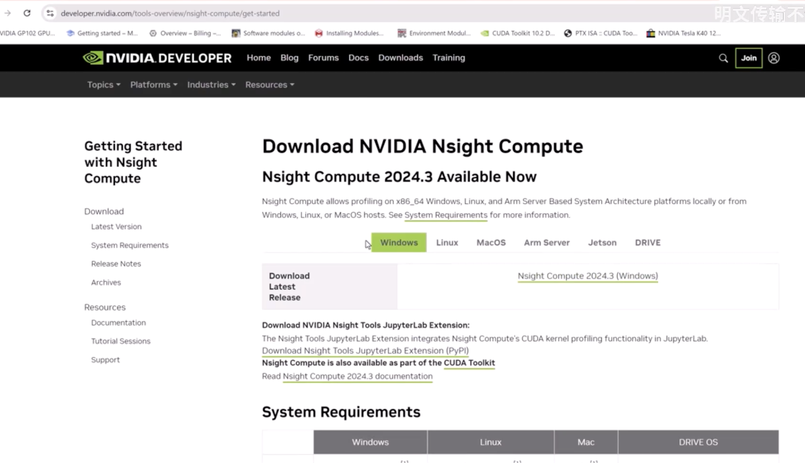
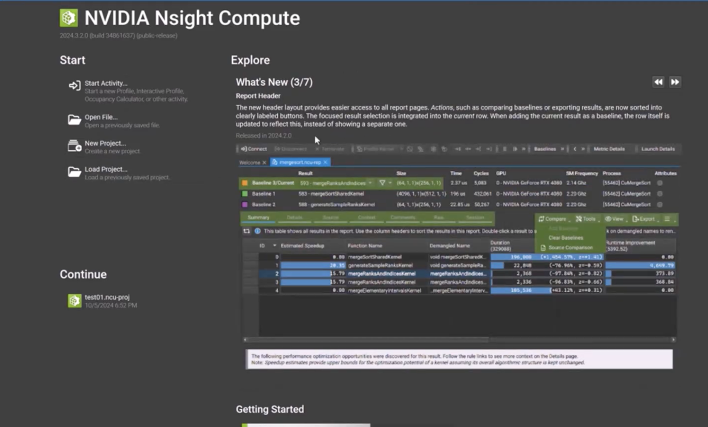
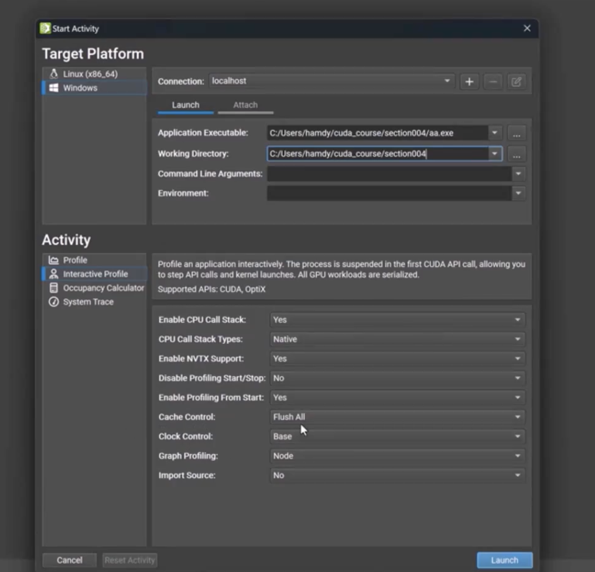
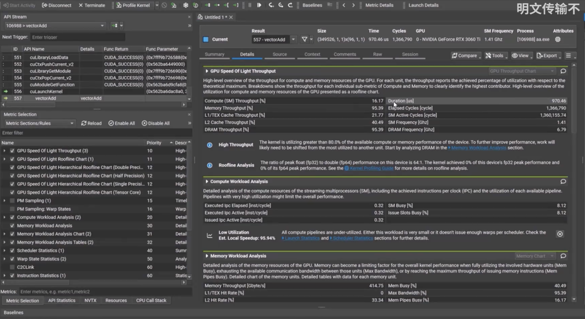
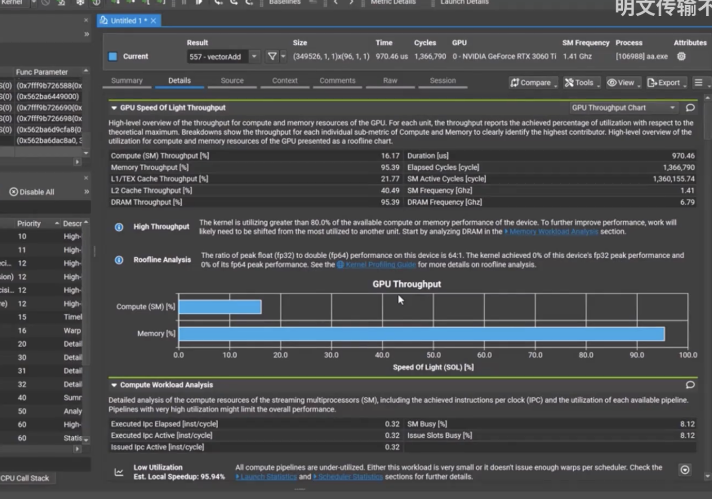
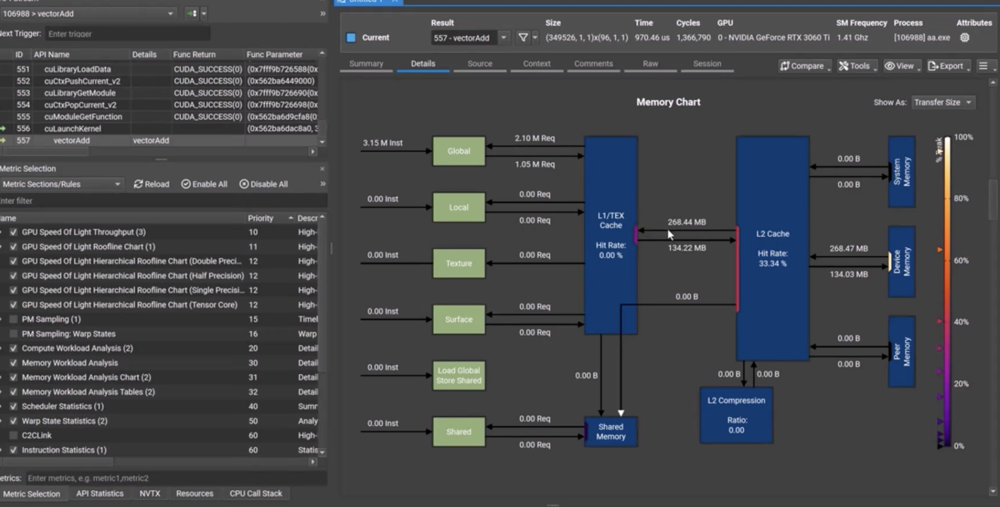
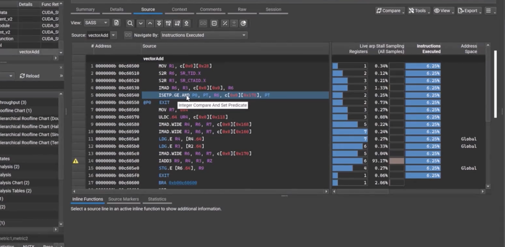
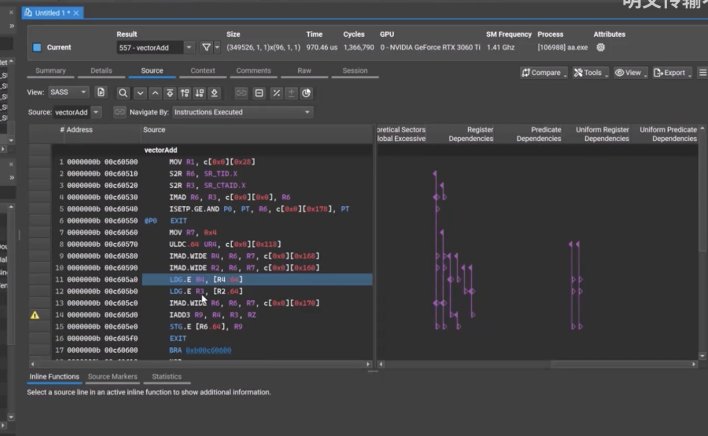
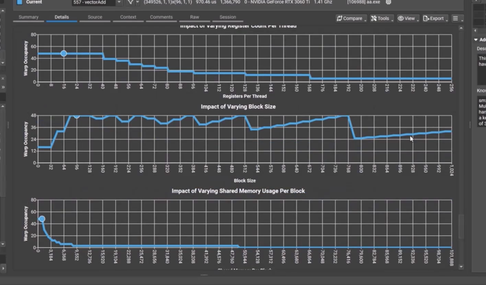

# 第 30 章 图形化 Nsight Compute

## 图形化Nsight Compute使用

前文讨论了 Nsight Compute 的命令行分析。Nsight Compute 提供两种分析方法：命令行分析（CLI）适合脚本化、快速收集少数指标；图形界面分析（GUI）提供屋顶线图（Roofline）、可视化图表与每个硬件单元的利用率，适合深入诊断。本章介绍 GUI 的使用。需要说明的是，Nsight Compute 有两份官方文档：一份是 [图形界面用户指南](https://docs.nvidia.com/nsight-compute/NsightCompute/index.html)，另一份是 [命令行用户指南](https://docs.nvidia.com/nsight-compute/NsightComputeCli/index.html)，本章以前者为准。

## 安装与启动

Nsight Compute 随 CUDA Toolkit 一并发布，也可从 NVIDIA 开发者网站独立下载。在 [Nsight Compute 下载页](https://developer.nvidia.com/tools-overview/nsight-compute/get-started)可选择 Windows、Linux、macOS、Arm Server 等平台的最新版本（如 2024.3），如图 [图 1](#fig-fig:ch30-download) 所示。安装完成后启动工具，首先呈现的是启动界面。

<a id="fig-fig:ch30-download"></a>



*图 1 Nsight Compute 官方下载页：提供 Windows/Linux/macOS/Arm Server 等平台安装包，也可作为 CUDA Toolkit 的一部分获取*

启动界面提供四个入口，如图 [图 2](#fig-fig:ch30-start) 所示：**Start Activity**（启动新的分析活动）、**Open File**（打开已保存的报告）、**New Project**（创建新项目）、**Load Project**（加载已有项目）。此外还有 Explore 区域展示版本更新要点。

<a id="fig-fig:ch30-start"></a>



*图 2 Nsight Compute GUI 启动界面：Start Activity / Open File / New Project / Load Project 四个入口，以及 Explore 中的版本更新说明*

## Start Activity 配置

点击 Start Activity 后弹出配置对话框，如图 [图 3](#fig-fig:ch30-startactivity) 所示，主要配置项包括：

- **Target Platform**：选择目标平台（Linux x86\_64、Windows 等）。
- **Activity**：选择活动类型——`Profile`（非交互式采集）、`Interactive Profile`（交互式分析）、`Occupancy Calculator`（占用率计算器）、`System Trace`（系统级追踪）。
- **Connection**：连接方式，`localhost` 为本地，也可远程连接。
- **Launch / Attach**：Launch 模式由工具直接启动目标程序；Attach 模式附加到已运行进程。Interactive Profile 需用 Launch 模式。
- **Application Executable / Working Directory / Command Line Arguments / Environment**：指定可执行文件路径、工作目录、命令行参数与环境变量。
- **Enable CPU Call Stack**：采集 CPU 调用栈，定位核函数的发起位置。
- **Enable NVTX Support**：启用 NVTX 标注范围过滤。
- **Cache Control**：`Flush All`（默认）在每次重放前清空 GPU 缓存，保证指标可重复；`None` 不清缓存，更快但指标可能不一致。
- **Clock Control**：`Base` 使用基础时钟频率；`None` 不锁定频率。
- **Graph Profiling**：CUDA Graph 分析模式（Node 级等）。
- **Import Source**：永久导入源文件用于 Source 页关联，需可执行文件内嵌行信息（`-lineinfo` 编译选项）。

<a id="fig-fig:ch30-startactivity"></a>



*图 3 Start Activity 配置对话框：选择目标平台、活动类型（Profile / Interactive Profile / Occupancy Calculator / System Trace）、Launch 或 Attach 模式，以及 Cache Control、Clock Control 等采集选项*

## 交互式分析与 Profile Kernel

选择 Interactive Profile 并 Launch 后，目标程序以插桩模式启动，并在第一个 CUDA API 调用（通常是 `cuInit`）处暂停所有线程，等待工具附加分析。界面顶部提供 **Profile Kernel**、**Disconnect**、**Terminate** 等控制按钮，下方 API Stream 列出已拦截的 CUDA 驱动 API 调用序列（如 `cuLibraryLoadData`、`cuCtxPushCurrent`、`cuModuleGetFunction`、`cuLaunchKernel`），如图 [图 4](#fig-fig:ch30-interactive) 所示。

<a id="fig-fig:ch30-interactive"></a>



交互式分析的工作流程为：程序运行至下一个核函数启动时暂停，点击 **Profile Kernel** 对该核函数采集指标，结果呈现在 Profiler Report 中；也可用 **Run to next kernel** 连续运行至下一个核函数。需要注意，Interactive Profile 模式下所有 GPU 工作负载被串行化，支持的 API 包括 CUDA 与 OptiX。

## Profiler Report 概览与页面结构

分析完成后进入 Profiler Report。报告由报告头与若干页面（Page）组成，页面标签位于 Attributes 行：**Summary**、**Details**、**Source**、**Context**、**Comments**、**Raw**、**Session**。报告头显示核函数名、网格与块维度、执行时间、周期数、GPU 型号与频率、进程名等概要信息。打开单结果报告默认进入 Details 页，多结果报告默认进入 Summary 页。

图 [图 5](#fig-fig:ch30-details) 展示了 Details 页的 GPU Speed Of Light Throughput 分段，给出本次 vectorAdd 的关键指标：Compute (SM) Throughput 16.17%、Memory Throughput 95.39%、L1/TEX Cache Throughput 21.77%、L2 Cache Throughput 40.49%、DRAM Throughput 95.39%，以及 Duration 970.46 textmu s、Elapsed Cycles 1,366,790、SM Frequency 1.41 GHz 等。

<a id="fig-fig:ch30-details"></a>



*图 5 Details 页 GPU Speed Of Light Throughput 分段：Compute 吞吐量仅 16.17% 而 Memory 达 95.39%，表明该核函数为内存瓶颈型；规则给出 High Throughput 与 Roofline Analysis 建议*

## Details 页与引导式分析

Details 页是所有采集指标的主页面，由多个分段（Section）组成。每个分段包含一个头部表格与可选的可展开主体（含图表或子表）。分段完全可自定义，修改对应的 `.section` 文件即可。

Details 页的核心价值在于**引导式分析（Guided Analysis）**。工具自动应用内置规则集（Rule），对每个分段生成 Recommendations，并给出两类加速比估计：

- **Est. Speedup**（全局估计）：工作负载整体运行时间的预期下降幅度。
- **Est. Local Speedup**（局部估计）：该规则针对的特定性能问题在硬件利用率上的预期提升。

在 Summary 页，**Prioritized Rules** 按预估加速比从高到低排序，点击规则名可直接跳转到 Details 页对应分段，便于聚焦最大的优化机会。例如图 [图 5](#fig-fig:ch30-details) 中的 High Throughput 规则提示核函数已超过 80% 的计算或内存性能上限，需将工作从最繁忙的单元转移到其他单元；Roofline Analysis 规则则指出该核函数仅达到 fp32 峰值的 0%。

Details 页还包含若干可视化子段：**Memory Workload Analysis** 的 Memory chart 以热力图可视化各级缓存间的数据传输量、命中率与内存请求；**Roofline** 图可缩放平移（支持 `+`/`-` 键与 Ctrl+滚轮）；**Source Counters** 的热点表指向 Source 页中的性能问题源码位置。

## 指标选择（Metric Selection）

图 [图 6](#fig-fig:ch30-metricsel) 展示了 Metric Selection 工具窗口，列出所有可用分段与规则及其优先级编号（Priority）。这里的分段即命令行中 `--section` 指定的内容，GUI 与 CLI 采集的是同一套指标，区别仅在呈现方式。窗口提供 **Reload**、**Enable All**、**Disable All** 与过滤框，可按需勾选。

<a id="fig-fig:ch30-metricsel"></a>



*图 6 Metric Selection 工具窗口：列出所有分段与规则（GPU Speed of Light Throughput、Compute/Memory Workload Analysis、Scheduler/Warp State Statistics、Instruction Statistics 等），带优先级编号 10--60*

主要分段及其优先级编号为：GPU Speed of Light Throughput（10）、Roofline Chart 与 Hierarchical Roofline Charts（11--12，按 Double/Half/Single/Tensor Core 精度）、PM Sampling 与 Warp States（15--16）、Compute Workload Analysis（20）、Memory Workload Analysis 及其 Chart/Tables（30--32）、Scheduler Statistics（40）、Warp State Statistics（50）、Instruction Statistics（60）。

## 内存与计算瓶颈分析

GPU Throughput Chart 是判断瓶颈类型的第一手依据。以图 [图 5](#fig-fig:ch30-details) 为例，Compute (SM) Throughput 仅 16.17% 而 Memory Throughput 高达 95.39%，二者悬殊表明该核函数为**内存瓶颈型（Memory Bound）**——大部分时间花在内存操作而非算术运算上。此时 95% 的高带宽并非好事，它意味着对全局内存访问过于频繁，应通过提高 L1/L2 命中率（如共享内存分块）来降低该数值。

**Compute Workload Analysis** 进一步分解各算术管道的利用率：FMA（融合乘加）、ALU（单精度/半精度/整数等）、LSU（加载存储单元）、FP64 等。本例 LSU 利用率约 16% 而 ALU/FMA 仅 3--4%，印证内存指令占比过高。

**Memory Workload Analysis** 展示各级内存的命中率、请求数与传输量：本例 L1 命中率 0%、L2 命中率 33%，大量请求未命中 L1 后穿透至 L2 甚至设备内存。Memory chart 以颜色编码标识各单元的繁忙程度（95% 处于峰值色区，0% 为深色）。

**Warp State Statistics**（Sub-warp 统计）给出停顿原因：本例每个 Sub-warp 平均停顿约 111 个周期，主要原因是 Long Scoreboard Dependency——即指令等待前序内存读取结果。这与低 L1/L2 命中率相互印证：内存访问未命中导致长延迟，后续依赖指令被迫停顿。

## Source 页与源码关联

Source 页将汇编（SASS）与高层代码（CUDA-C、PTX、Python 等）关联，并显示指令级指标，是 GUI 相对 CLI 最具优势的功能。图 [图 7](#fig-fig:ch30-source) 展示了 vectorAdd 核函数的 SASS 反汇编，其核心指令序列如下：

```asm
MOV  R1, c[0x0][0x28]       ; 取常量
S2R  R6, SR_TID.X           ; 读线程 ID
S2R  R3, SR_CTAID.X         ; 读块 ID
IMAD R6, R3, c[0xe][0xe], R6 ; 计算全局线程索引
ISETP.GE.AND P0, PT, R6, c[0x3][0x178], PT  ; i >= N?
EXIT                          ; 越界则退出
ULDC.64 UR5, c[0x0][0x118]
IMAD.WIDE R1, R6, R7, c[0xe][0x168]
IMAD.WIDE R2, R6, R7, c[0xe][0x160]
LDG.E R4, [R1.64]            ; 从全局内存加载 A[i]
LDG.E R3, [R2.64]            ; 从全局内存加载 B[i]
IMAD.WIDE R6, R6, R7, c[0x0][0x170]
IADD3 R9, R4, R3, R2         ; C[i] = A[i] + B[i]
STG.E [R6.64], R9            ; 存储到全局内存
EXIT
BRA                           ; 循环跳回
```

<a id="fig-fig:ch30-source"></a>



Source 页的关键特性包括：

- **视图切换**：`View` 下拉可在 SASS、PTX、Source（CUDA-C）间切换，或并排显示两层。CUDA-C 视图需用 `-lineinfo`（或 `--generate-line-info`）nvcc 选项编译以嵌入行信息。
- **导航**：`Navigate By` 按已执行指令数、停顿采样等排序；热点表可从 Source Counters 分段跳转到对应源码行。
- **依赖关系**：如图 [图 8](#fig-fig:ch30-deps) 所示，右侧可显示 Register Dependencies、Predicate Dependencies 等列，鼠标悬停指令会以箭头标注其依赖的前序指令（如 `IADD3` 依赖 `LDG.E` 的 R4 与 R3）。
- **符号标签**：SASS 反汇编中的分支目标与函数调用显示为可点击超链接，点击即跳转到对应地址行。
- **停顿归因**：每条指令旁标注其导致的停顿占比，例如加载指令 `LDG.E` 与存储指令 `STG.E` 各贡献约 84--93% 的 Sub-warp 停顿，直观定位热点指令。
- **搜索**：支持正则表达式与值比较（如 `>= 5`），按列搜索。

<a id="fig-fig:ch30-deps"></a>



*图 8 Source 页带依赖关系列：Register/Predicate/Uniform Register/Uniform Predicate Dependencies 列标注每条指令的寄存器与谓词依赖，鼠标悬停可高亮前序来源指令*

## 占用率计算器与基线对比

报告头或 Occupancy 分段的计算器按钮可打开**占用率计算器（Occupancy Calculator）**，如图 [图 9](#fig-fig:ch30-occ) 所示。它以交互式图表展示改变配置对 Warp 占用率的影响：

- **Impact of Varying Block Size**：调整每块线程数，观察占用率变化。本例块大小 96 增至 128 不影响占用率，但增至 800 会使占用率从约 48% 降至 24%。
- **Impact of Varying Shared Memory Usage Per Block**：调整每块共享内存用量对占用率的影响。
- **Registers Per Thread**：调整每线程寄存器数。本例 16 个寄存器，增至 40 仍不降低占用率，超过 40 才会下降。

<a id="fig-fig:ch30-occ"></a>



*图 9 占用率计算器：交互式调整块大小、每块共享内存、每线程寄存器数，实时观察 Warp 占用率的变化曲线，辅助在不损失占用率的前提下优化资源分配*

此外，GUI 还提供以下实用功能：

- **基线对比（Baseline）**：用 Compare -- Add Baseline 将当前结果设为基线，此后所有元素同时显示当前值与基线值（或变化百分比），Details 分段头部以 Difference Bars 图形化差异。优化迭代时可直接观察改动效果。
- **注释（Comments）**：每个分段可添加注释（气泡图标），注释持久保存于报告并汇总在 Comments 页，便于团队协作。
- **导出（Export）**：报告可导出为 PDF、图像等格式。
- **API Statistics**：显示 CUDA Runtime/Driver API 调用耗时，如 `cudaMemcpy` 约 40 ms、`cudaMalloc` 约 7 ms，用于评估非核函数部分的开销。

## 本章小结

- Nsight Compute GUI 通过 Start Activity 配置采集方式，Interactive Profile 模式可逐核函数分析，Profiler Report 按页面（Summary/Details/Source/Raw 等）组织结果。
- Details 页的引导式分析自动应用规则集，给出带加速比估计的优化建议；Prioritized Rules 按预估收益排序，帮助聚焦最大优化机会。
- GPU Throughput Chart 用于判断瓶颈类型（计算瓶颈型 vs 内存瓶颈型），Compute/Memory Workload Analysis 与 Warp State Statistics 进一步定位具体管道与停顿原因。
- Source 页关联 SASS 与源码，标注每条指令的停顿占比与寄存器依赖，是定位热点指令的核心工具。
- 占用率计算器交互式评估块大小、寄存器、共享内存对占用率的影响；基线对比功能便于优化迭代。
- 后续性能优化章节将基于 GUI 采集的结果展开具体优化实践。
