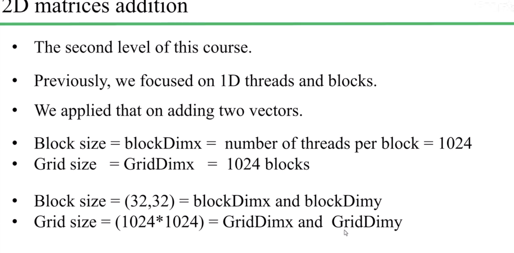
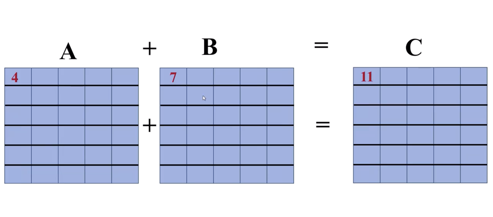
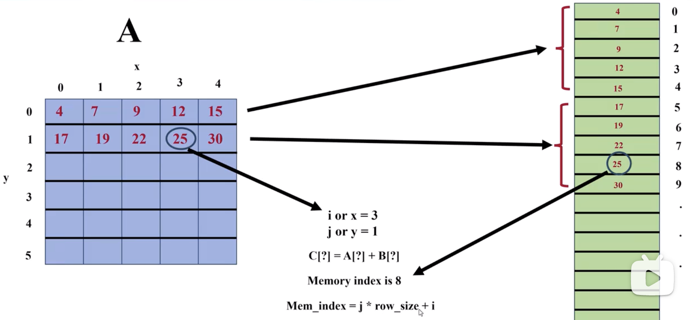
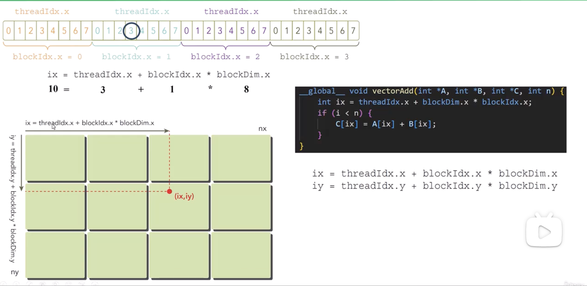
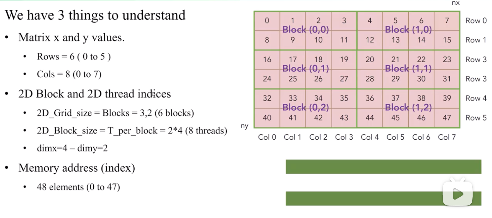

# 第 33 章 二维线程块矩阵加法

## 基于二维线程块与线程的矩阵加法

本章进入课程第二阶段：从一维线程块扩展到二维线程块，并将之应用于二维矩阵加法。前文所有示例（向量加法）仅使用 `blockDim.x` 与 `gridDim.x` 两个一维配置；处理矩阵时需引入 `blockDim.y` 与 `gridDim.y`，并解决二维索引到一维内存地址的映射问题。

## 二维线程块配置

<a id="fig-ch33-1"></a>



CUDA 提供四类内建变量描述线程块与网格的维度：

| 变量 | 含义 |
| --- | --- |
| `blockDim.x/y` | 线程块在 X、Y 维度的线程数 |
| `gridDim.x/y` | 网格在 X、Y 维度的线程块数 |
| `threadIdx.x/y` | 块内线程在 X、Y 维度的索引 |
| `blockIdx.x/y` | 网格内线程块在 X、Y 维度的索引 |

二维配置的关键约束是：**`blockDim.x` 与 `blockDim.y` 的乘积不得超过 1024**（Ampere 架构上限）。例如 `(32, 32)` 合法（乘积 1024），`(1024, 2)` 非法（乘积 2048，编译通过但启动失败）。两维取值可自由调整，如 `(64, 16)`、`(128, 8)` 等，每种组合都可能影响性能，需实测择优。

## 行主序内存存储

<a id="fig-fig:ch33-matrix-add"></a>



*图 2 矩阵加法 C = A + B：对应位置的元素逐一相加*

矩阵加法 C = A + B 逐元素相加（图 [图 2](#fig-fig:ch33-matrix-add)），逻辑简单。难点在于：矩阵在代码中是二维的，而显存是一维的——需明确二维元素如何存储到一维内存中。

CUDA 采用**行主序（Row-major）**存储：矩阵每一行的元素在内存中连续排列。以图 [图 3](#fig-fig:ch33-index-map) 为例，第一行元素 4, 7, 9, 0, 2 依次存入地址 0--4，第二行紧接其后存入地址 5--9，以此类推。这样，二维矩阵被"铺平"为一维数组，行与行首尾相接。

## 二维索引映射

<a id="fig-fig:ch33-index-map"></a>



行主序下，二维坐标 (i, j)（列 i、行 j）映射到一维内存索引的公式为：

> index = j × row\_size + i

其中 `row_size` 为每行的元素数（列数）。以图 [图 3](#fig-fig:ch33-index-map) 为例，元素 25 位于第 1 行第 3 列（j=1, i=3），行宽为 5，故 index = 1 × 5 + 3 = 8，与内存地址 8 对应。

## 从一维到二维的索引扩展

<a id="fig-fig:ch33-1d-to-2d"></a>



一维向量加法中，线程索引公式为（图 [图 4](#fig-fig:ch33-1d-to-2d) 上半部分）：

> ix = textttthreadIdx.x + textttblockIdx.x × textttblockDim.x

扩展到二维矩阵时，行内位置仍用 ix 计算（公式相同），再增加 iy 定位具体行（图 [图 4](#fig-fig:ch33-1d-to-2d) 下半部分）：

> iy = textttthreadIdx.y + textttblockIdx.y × textttblockDim.y

最终内存索引将 ix、iy 与矩阵列数 nx 结合：

> index = iy × nx + ix

## 二维矩阵配置实例

<a id="fig-fig:ch33-config-example"></a>



以 6 × 8 矩阵为例（图 [图 5](#fig-fig:ch33-config-example)），三要素需对应：

- **矩阵大小**：6 行（0--5）× 8 列（0--7），共 48 元素。
- **线程块与线程**：网格 3 × 2（6 块），每块 4 × 2（8 线程），即 `blockDim.x = 4`、`blockDim.y = 2`、`gridDim.x = 3`、`gridDim.y = 2`。
- **内存索引**：48 个元素按行主序编号 0--47。

以元素 44 为例验证映射：该元素位于块 (1, 2) 内，块内线程索引为 (0, 1)。计算 ix = 0 + 1 × 4 = 4，iy = 1 + 2 × 2 = 5，index = 5 × 8 + 4 = 44，与内存索引吻合。

## 二维矩阵加法示例代码

```cpp
#include <stdio.h>
#include <cuda_runtime.h>

// 二维矩阵加法核函数
__global__ void matrix_add(const float* A, const float* B,
                           float* C, int nx, int ny) {
    int ix = threadIdx.x + blockIdx.x * blockDim.x;
    int iy = threadIdx.y + blockIdx.y * blockDim.y;
    if (ix < nx && iy < ny) {
        int idx = iy * nx + ix;      // 二维坐标 -> 一维内存索引
        C[idx] = A[idx] + B[idx];
    }
}

int main() {
    int nx = 4096, ny = 4096;
    size_t bytes = (size_t)nx * ny * sizeof(float);

    float *h_A = (float*)malloc(bytes);
    float *h_B = (float*)malloc(bytes);
    float *h_C = (float*)malloc(bytes);
    for (int i = 0; i < nx * ny; i++) {
        h_A[i] = 1.0f;
        h_B[i] = 2.0f;
    }

    float *d_A, *d_B, *d_C;
    cudaMalloc(&d_A, bytes);
    cudaMalloc(&d_B, bytes);
    cudaMalloc(&d_C, bytes);
    cudaMemcpy(d_A, h_A, bytes, cudaMemcpyHostToDevice);
    cudaMemcpy(d_B, h_B, bytes, cudaMemcpyHostToDevice);

    // 二维块大小与网格大小
    dim3 block(32, 32);                          // 每块 1024 线程
    dim3 grid((nx + block.x - 1) / block.x,
              (ny + block.y - 1) / block.y);     // 128 x 128

    matrix_add<<<grid, block>>>(d_A, d_B, d_C, nx, ny);
    cudaDeviceSynchronize();

    cudaMemcpy(h_C, d_C, bytes, cudaMemcpyDeviceToHost);
    printf("C[0]=%.1f, C[last]=%.1f\n", h_C[0], h_C[nx*ny-1]);

    cudaFree(d_A); cudaFree(d_B); cudaFree(d_C);
    free(h_A); free(h_B); free(h_C);
    return 0;
}
```

关键点说明：

- 核函数中 `ix`、`iy` 分别由 `threadIdx` 与 `blockIdx` 在 X、Y 维度计算，与一维公式结构相同。
- `idx = iy * nx + ix` 即行主序映射公式，将二维坐标转换为一维内存索引。
- `if (ix < nx && iy < ny)` 为越界检查，处理矩阵维度非块大小整数倍的情况。
- `dim3` 类型用于指定二维配置：`block(32, 32)` 设定每块线程数，`grid(...)` 按向上取整计算网格块数。本例 4096 / 32 = 128，故 `grid` 为 128 × 128。
- 总线程数 = 32 × 32 × 128 × 128 = 16,777,216，恰等于 4096 × 4096 元素数，无空闲线程。

## 性能分析与块大小优化

用 `ncu` 分析上述程序，调整块大小可显著影响性能。以 `block(32, 32)` 与 `block(16, 16)` 两种配置对比：

| 块大小 | 每块线程 | 每块 Warp | 每 SM 活动块 | 占用率 |
| --- | --- | --- | --- | --- |
| `(32, 32)` | 1024 | 32 | 1 | 50% |
| `(16, 16)` | 256 | 8 | 6 | 74% |

`(32, 32)` 时每块达 1024 线程（32 个 Warp），SM 资源被单块占满，每 SM 仅能驻留 1 个块，占用率仅 50%。改为 `(16, 16)` 后，每块仅 256 线程（8 个 Warp），SM 可同时驻留 6 个块，占用率升至 74%，执行时间相应缩短。

可见，**块大小并非越大越好**：过大的块会耗尽 SM 的寄存器与调度资源，限制可并发驻留的块数，反而降低占用率。应在满足元素覆盖的前提下，选择使每 SM 活动块数最大化的块大小配置。本例中 L1 命中率约 1%（几乎为 0，因未使用共享内存）、L2 命中率约 33%，两种配置下基本一致——块大小主要影响占用率与调度，对缓存命中率影响较小，后者将在后续章节讨论。

## 本章小结

- 二维线程块引入 `blockDim.y`、`gridDim.y`，约束为 `blockDim.x × blockDim.y ≤ 1024`。
- 行主序存储下，二维坐标 (ix, iy) 映射到一维内存索引：index = iy × nx + ix。
- ix、iy 分别由 X、Y 维度的 `threadIdx` 与 `blockIdx` 按与一维相同的公式计算。
- 块大小影响占用率：过大的块（如 32×32）使每 SM 仅驻留 1 块，占用率低；较小的块（如 16×16）允许多块并发，占用率更高。
- 核函数需以 `if (ix < nx && iy < ny)` 做越界检查，处理非整数倍维度。
