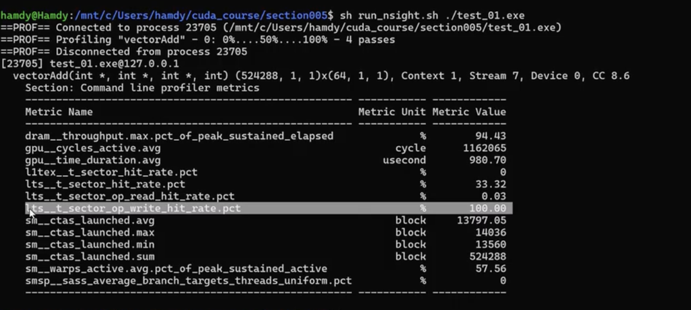

# 第 34 章 L1 缓存命中率为零

## L1缓存命中率为零的原因分析

## 摘要

本章继续探讨矩阵加法应用程序的性能分析，重点聚焦于 L1 和 L2 缓存命中率。通过回顾 NVIDIA GPU（以 Ampere 架构为例）的内存层次结构，深入解析为何在矩阵加法中 L1 缓存命中率为零，并揭示 NVIDIA Nsight Compute 工具在统计 L2 缓存命中率时将所有写入操作视为"命中"的特殊机制。最后通过向量加法案例验证了这一结论，强调了在性能评估中区分读取命中率与总命中率的重要性。

## 引言：矩阵加法回顾

本章将继续讨论之前的应用程序案例，即两个矩阵相加并将结果存储在第三个矩阵中。具体而言，将矩阵 A 的所有元素与矩阵 B 的对应元素相加，结果存入矩阵 C 的对应位置（例如 4+7=11）。在上一章中，已经讨论了矩阵相加的原理和概念。

本章的主要目的是进行性能分析，重点关注 L1 和 L2 缓存的命中率。

## NVIDIA GPU 内存层次结构回顾

为了理解缓存行为，需要回顾 NVIDIA GPU 的硬件实现。以下讲解基于 NVIDIA 白皮书中的内存层次结构图（以 Volta 或 Ampere 架构为例）。

## 全局内存与 HBM

从最底层的全局内存（设备内存）开始，现代高端 GPU 通常采用 HBM（High Bandwidth Memory，高带宽内存）。相较于 DDR3/4/5 等传统内存，HBM 以其极高的带宽著称。以 A100 GPU 为例，其显存总线宽度超过 5000 位（远超 CPU 端常见的 64 位），带宽可达每秒 1.5 至 1.9 TB。这是一个极其庞大的数据传输能力。

## L2 缓存

L2 缓存被划分为多个分区（Slice），在所有 SM 之间共享。HBM 通过内存控制器连接到 L2 缓存。无论请求来自哪个 SM，数据都可以通过 L2 缓存进行发送或接收。对于 HBM2e 等规格，L2 缓存同样包含多个物理分区，数据可根据 SM 的访问请求在分区间移动。

## L1 数据缓存与共享内存

深入到单个 SM 内部，L1 数据缓存与共享内存（Shared Memory）共用同一个物理存储单元。在 Ampere 架构中，该单元的最大容量为 192 KB。开发者可以配置应用程序，将此容量按需分配给共享内存和 L1 数据缓存（例如：100 KB 用于共享内存，92 KB 用于 L1 缓存）。

需要注意的是：

- L1 缓存仅在单个 SM 内部共享，不在不同 SM 之间共享。
- 共享内存同理，仅局限于 SM 内部。

## 数据访问流程与 L1 命中率分析

## 数据加载路径

当应用程序运行时，数据通常初始存储于 HBM 中。当 SM 内的计算核心（ALU、Tensor Core 等）需要全局内存数据时，流程如下：

1. 核心向加载/存储单元（Load/Store Unit）发送请求。
2. 加载/存储单元首先查询 L1 缓存。若命中，数据直接返回核心；若未命中，请求转发至 L2 缓存。
3. 若 L2 缓存命中，数据返回 SM；若仍未命中，则向 HBM 发起请求。

## 为何矩阵加法的 L1 命中率为零？

在矩阵加法 C = A + B 中，每个元素仅被访问一次：读取 A 的元素，读取 B 的元素，计算后写入 C。由于没有数据复用（Reuse），同一个元素不会被再次读取。因此，理论上该应用的 L1 缓存命中率应为 0。这与在 Nsight Compute 中观察到的结果一致。

相比之下，在矩阵乘法中，矩阵 A 的一行会与矩阵 B 的多列反复相乘，存在显著的数据复用，因此会产生大于零的 L1/L2 命中率。

**注意：** 块大小（Block Size）的配置可能会影响实际的缓存行为，但基本原理不变。

## L1 缓存技术细节与合并访问

关于 L1 缓存的关键参数：

- **最大容量：** 192 KB（可配置）。
- **缓存行大小：** 128 Bytes。

## 线程束（Warp）与内存合并

每个线程束由 32 个线程组成。当一个线程束执行加载指令时，32 个线程在同一周期内发出请求。加载/存储单元会根据地址连续性将这些请求合并（Coalesce）。

**示例：** 假设 32 个线程各加载一个 4 字节的浮点数，且内存地址连续。总数据量为 32 × 4 = 128 字节，恰好等于一个缓存行的大小。此时，加载/存储单元会将 32 个独立请求合并为单次 L1 缓存行请求，极大提升效率。

## L2 缓存命中率的"秘密"：写入操作被视为命中

## 观测到的异常现象

在矩阵加法测试中，虽然 L1 命中率为 0，但 L2 总命中率却显示约为 33%。这与理论预期不符。

## 原因解析

这是 NVIDIA Nsight Compute 工具的一个特殊统计机制：**L2 缓存中的所有写入（Store）操作均被计为"命中"，即使实际并未命中缓存。**

在矩阵加法中，每个元素对应三次操作：

- 加载 A（Read）：未命中
- 加载 B（Read）：未命中
- 存储 C（Write）：**被工具计为命中**

因此，命中率计算公式为：

> L2 Hit Rate = (Write Ops) Read Ops+ Write Ops = (100) 100 + 100 + 100 ≈ 33.3%

## 验证实验

通过向量加法程序验证了这一结论：

```bash
使用Nsight Compute运行分析
ncu --metrics l1tex__hit_rate,lts__hit_rate ./vector_add
```

结果显示：

- L1 命中率：0%
- L2 总命中率：33.33%
- L2 读取命中率（lts\_read\_hit\_rate）：≈ 0%
- L2 写入命中率（lts\_write\_hit\_rate）：100%

<a id="fig-ch34-1"></a>



## 关键结论与建议

1. 在矩阵加法等无数据复用的场景中，L1 缓存命中率确实为 0。
2. NVIDIA Nsight Compute 将 L2 写入操作强制计为命中，导致 L2 总命中率虚高。
3. **性能评估建议：** 在评估 L2 缓存性能时，应仅关注**读取命中率**（Read Hit Rate），而非总命中率，以获得公平准确的评估。此规则不适用于 L1 缓存。

## 结语

本章到此结束。矩阵加法中缓存命中率的成因及工具统计特性，如有疑问，可发送邮件或在 NVIDIA 开发者论坛中搜索相关讨论，那里包含大量宝贵信息。
