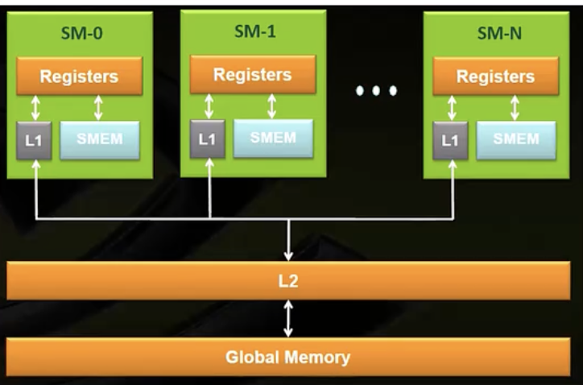
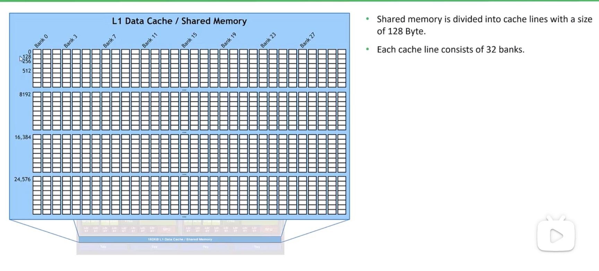
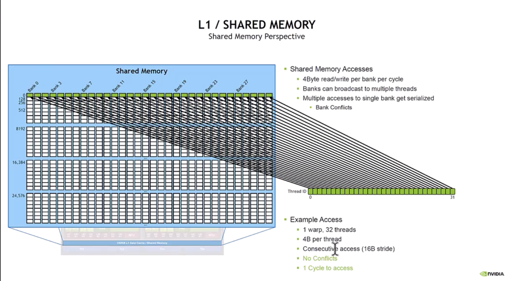
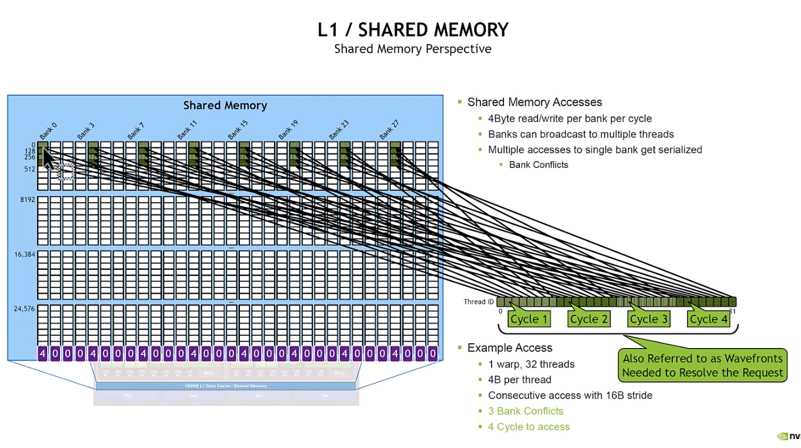

# 第 35 章 共享内存技术详解

## CUDA GPU 并行编程：共享内存技术详解

## 引言

在 NVIDIA GPU 的内存层次结构中，共享内存（Shared Memory）是提升并行程序性能的关键组件。本章基于相关技术讲座内容，对共享内存的硬件架构、软件编程接口、存储体（Bank）组织形式以及存储体冲突（Bank Conflict）等核心概念进行系统性的修正与总结。

## GPU 内存层次结构概述

NVIDIA GPU 内部包含多种内存类型，其访问延迟与可见性各不相同：

- **全局内存（Global Memory）**：对所有线程及 CPU 可见，容量大但延迟高（>300 个时钟周期）。
- **二级缓存（L2 Cache）**：在所有 SM 之间共享，延迟约为 200 个时钟周期。
- **一级缓存（L1 Cache）**：位于 SM 内部，仅对当前 SM 内的线程可见。它是硬件管理的缓存，程序员无法直接控制其分配与替换策略，延迟约为 33 个时钟周期。
- **寄存器（Registers）**：按线程私有分配，生命周期与线程一致，是速度最快的存储单元。
- **共享内存（Shared Memory）**：位于 SM 内部，属于软件可管理的缓存，延迟极低（约 20--25 个时钟周期）。

## 共享内存的架构特性

## 硬件与软件的融合

在现代 NVIDIA 架构（如 Turing、Ampere）中，L1 缓存与共享内存通常位于同一个物理存储单元中。该物理单元的总容量是固定的，通过编译器或配置 API 在 L1 缓存与共享内存之间进行动态划分。

## Ampere 架构配置示例

以 Ampere 架构（如 A100 GPU）为例，单个 SM 的 L1/共享内存物理单元总大小为 192KB。

- 若配置共享内存为 0 KB，则 L1 缓存为 192 KB。
- 若配置共享内存为 8 KB，则 L1 缓存为 184 KB。
- 共享内存的最大可配置容量通常为 164 KB，因为必须保留部分空间作为 L1 缓存。

通常情况下，编译器会根据代码中的 `__shared__` 变量声明自动完成最优配置，开发者无需手动干预。

## 可编程性与数据重用

与 L1 缓存不同，共享内存是可编程的。开发者可以通过 `__shared__` 关键字显式声明变量，精确控制数据的存储位置、步长及存储体映射。这种特性使其成为实现线程间通信、数据重用及减少全局内存访问（Memory Bottleneck）的最佳选择。

## 共享内存的物理组织

共享内存被划分为多个**缓存行（Cache Line）**和**存储体（Bank）**：

- **缓存行**：每行大小为 128 字节。
- **存储体**：每个缓存行包含 32 个存储体。
- **存储体大小**：128 Bytes / 32 = 4 Bytes。

**访问规则**：每个时钟周期，每个存储体（列）仅能处理一次读/写操作。若同一周期内有多个线程访问同一存储体的不同地址，将发生存储体冲突。

## 存储体冲突（Bank Conflict）详解

## 冲突定义与计算

存储体冲突发生在同一个 Warp（32 个线程）内的多个线程同时访问**同一存储体中的不同地址**时。

> 冲突次数 = 单存储体最大并发访问次数 - 1

例如，若某存储体在同一周期被 4 个线程访问，则产生 4 - 1 = 3 次冲突，该次访问需要 4 个时钟周期才能完成。

## 典型访问模式分析

1. **无冲突访问（步长为 1）**：  
   当 32 个线程以 4 字节步长连续访问时，每个线程恰好映射到不同的存储体（Bank 0 到 Bank 31）。此时无冲突，1 个周期即可完成。

2. **广播机制（Broadcast）**：  
   若多个线程访问**完全相同的地址**（同一存储体、同一偏移量），硬件会触发广播机制，将数据同时发送给所有请求线程，**不产生存储体冲突**。

3. **有冲突访问（步长为 16 字节）**：  
   若步长为 16 字节（即跨越 4 个存储体），线程 0 访问 Bank 0，线程 1 访问 Bank 4，线程 2 访问 Bank 8。此时，Bank 0 会被线程 0、8、16、24 同时访问。最大并发数为 4，因此产生 3 次冲突，耗时 4 个周期。

## 双精度数据类型

对于 8 字节的双精度（Double）数据，每个线程需访问 2 个连续的存储体。32 个线程共需访问 64 个存储体位置（跨越 2 个缓存行）。由于每个存储体每周期仅能服务一次，理论上至少需要 2 个周期。在实际硬件实现中，NVIDIA 可能通过特殊的交织访问机制优化此类场景，导致 Nsight Compute 等工具报告的冲突数可能与纯理论计算存在差异。

## 总结

共享内存是 CUDA 编程中优化内存带宽的核心手段。理解其底层物理结构（32 Banks，4 Bytes/Bank）及冲突机制，对于编写高性能核函数至关重要。开发者应：

1. 尽量采用步长为 1 的连续访问模式。
2. 利用广播机制处理只读常量数据。
3. 避免不必要的跨步访问（Strided Access）。
4. 信任编译器的自动配置，但在极端性能需求下可手动调整 L1/共享内存比例。
