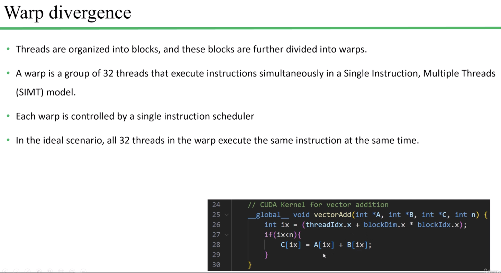

# 第 36.1 章 线程束分化（Warp Divergence）

线程束分化是 CUDA 性能优化的核心主题之一。当同一线程束内的线程因条件分支走向不同执行路径时，GPU 无法让这些路径并行执行，只能将其串行化，导致部分线程空闲、吞吐量下降。本章系统阐述线程束分化的成因、执行机制、程度分类及性能影响。

## SIMT 模型回顾

<a id="fig-fig:ch361-simt"></a>



*图 1 SIMT 执行模型与线程束调度：线程组织为线程块，块进一步划分为线程束；一个线程束含 32 个线程，由单个指令调度器控制，理想情况下同时执行同一条指令*

CUDA 采用 SIMT（单指令多线程）执行模型（图 [图 1](#fig-fig:ch361-simt)）。其层次结构为：线程（Thread）组织为线程块（Block），线程块进一步划分为线程束（Warp），每个线程束由 32 个线程组成。流多处理器（SM）内部设有线程束调度器，负责将线程束调度到可用的硬件核心上执行。

在理想场景下，线程束内的 32 个线程在每个时钟周期执行**同一条指令**（如向量加法），仅操作的数据元素不同。以 `vectorAdd` 核函数为例：

```cpp
__global__ void vectorAdd(int *A, int *B, int *C, int n) {
    int ix = threadIdx.x + blockDim.x * blockIdx.x;
    if (ix < n) {
        C[ix] = A[ix] + B[ix];
    }
}
```

核函数中 `C[ix] = A[ix] + B[ix]` 这条加法指令由线程束内所有线程同时执行，各线程按自身索引 `ix` 访问不同数据。这就是 SIMT 的高效之处：一条指令驱动 32 个计算单元并行工作。

## 线程束分化的成因

SIMT 模型的高效建立在一个前提上：线程束内所有线程执行相同的指令序列。当核函数包含 `if-else` 等条件分支，且分支条件在同一线程束的不同线程间取值不同时，该前提被打破，即产生线程束分化。

需区分两类条件语句：

- **边界检查（不导致分化）**：如上例中的 `if (ix < n)`。该条件仅在最后一个线程束的末尾少数线程中触发（当 n 非 32 倍数时），不会在同一线程束的多个线程中同时产生不同的真假值，故不构成分化。
- **数据依赖分支（导致分化）**：如 `if (threadIdx.x < 16)`。该条件在同一线程束内前 16 个线程为真、后 16 个线程为假，两部分线程走向不同路径，构成典型的线程束分化。

判断是否分化的关键在于：**分支条件在同一线程束的 32 个线程中是否同时存在真值与假值**。若是，则分化；若整个线程束统一取真或统一取假，则不分化。

## 串行化执行机制

线程束分化时，GPU 采用**掩码（Masking）机制**串行执行各分支。以 `if-else` 为例，假设线程束内部分线程走 if 分支、部分走 else 分支：

1. 线程束内 32 个线程同时到达 `if` 语句，各自测试条件。
2. GPU 激活条件为真的线程（置掩码位为 1），条件为假的线程被屏蔽（掩码位为 0，处于空闲状态），执行 if 分支体。
3. if 分支体执行完毕后，GPU 激活此前被屏蔽的线程，执行 else 分支体；此前已执行的线程此时被屏蔽。
4. 所有分支执行完毕后，线程束在分支结束处**汇合**（Reconverge），继续同步执行后续指令。

由此可见，分化使原本并行的两条路径变为**串行**执行：if 分支执行时，走 else 的线程空闲；else 分支执行时，走 if 的线程空闲。总执行时间为两分支时间之和，而非较长分支的时间。

## 分化程度分类

按线程束内分化分支的数量，可分为三级：

| 分化程度 | 特征 | 性能影响 |
| --- | --- | --- |
| 无分化 | 32 线程执行同一路径 | SIMT 理想场景，所有线程活跃，性能最优 |
| 中度分化 | 2 条路径（如 if-else） | 一半线程执行时另一半空闲，利用率约 50% |
| 严重分化 | 多条路径（如多重 if） | 大多数时钟周期内多数线程空闲，性能损失显著 |

以偶数/奇数线程分组为例的严重分化：32 个线程被 `if (threadIdx.x % 2 == 0)` 分为两组，虽仅 2 条路径，但若分支体内再嵌套条件判断，路径数会进一步增多，每个时钟周期内活跃线程比例急剧下降。

## 性能影响

线程束分化对性能的影响可归纳为以下几方面：

- **串行化执行**：分化分支被依次执行，总时间为各分支时间之和，而非最大分支时间。
- **资源利用率低**：任意时刻仅部分线程执行有效工作，被屏蔽的线程占用 SM 资源却不产出计算。
- **吞吐量降低**：每个时钟周期的活跃线程数减少，指令吞吐量相应下降。
- **执行时间增加**：控制流切换与分支串行化迫使 GPU 在不同路径间切换，增加内核整体完成时间。

需注意，分化仅发生于**同一线程束内**。不同线程束之间的分支差异不构成分化，因各线程束由独立的调度单元管理，本就可交错执行。

## 分化示例代码与优化

以下示例对比线程束分化与无分化两种实现：

```cpp
#include <stdio.h>
#include <cuda_runtime.h>

// 分化版本：if-else 导致同一线程束内两条路径
__global__ void divergent_kernel(float* C, int n) {
    int ix = threadIdx.x + blockIdx.x * blockDim.x;
    if (ix < n) {
        if (threadIdx.x < 16) {
            C[ix] = ix * 2.0f;          // 路径 A：前 16 线程
        } else {
            C[ix] = ix + 1.0f;          // 路径 B：后 16 线程
        }
    }
}

// 优化版本：消除分支，用条件表达式替代 if-else
__global__ void nondivergent_kernel(float* C, int n) {
    int ix = threadIdx.x + blockIdx.x * blockDim.x;
    if (ix < n) {
        float a = (threadIdx.x < 16) ? ix * 2.0f : ix + 1.0f;
        C[ix] = a;
    }
}

int main() {
    int n = 1024;
    size_t bytes = n * sizeof(float);
    float *d_C;
    cudaMalloc(&d_C, bytes);

    int block = 32, grid = (n + block - 1) / block;

    divergent_kernel<<<grid, block>>>(d_C, n);
    cudaDeviceSynchronize();

    nondivergent_kernel<<<grid, block>>>(d_C, n);
    cudaDeviceSynchronize();

    cudaFree(d_C);
    return 0;
}
```

**优化原理**：三元运算符 `?:` 在多数情况下被编译器转换为**断定指令（Predicated Instruction）**——两条路径的计算均执行，但通过断定寄存器仅写回满足条件的结果，避免控制流分支。虽多执行了一条路径的计算，但消除了串行化等待，整体吞吐量通常更高。

**分支效率（Branch Efficiency）**是衡量分化程度的指标，可通过 `ncu` 采集：

```bash
ncu --metrics smsp__sass_average_branch_targets_threads_uniform.pct \
    ./divergent_demo
```

该指标反映线程束内分支目标的一致性：值越高表示分化越少。无分化时接近 100%，存在 `if-else` 分化时显著下降。

## 本章小结

- SIMT 模型要求线程束内 32 线程执行相同指令序列；当 `if-else` 条件在同一线程束内产生不同取值时，发生线程束分化。
- 分化时 GPU 通过掩码机制串行执行各分支：先执行一支并屏蔽另一支，再执行另一支，最后在分支结束处汇合。
- 分化使总执行时间为各分支时间之和，被屏蔽线程空闲，吞吐量与资源利用率下降。
- 边界检查（如 `if (ix < n)`）不导致分化，因其不在同一线程束内同时产生不同取值。
- 消除分化的常用手段是用三元运算符替代 `if-else`，借助断定指令避免控制流分支。
- 分支效率指标（`smsp__sass_average_branch_targets_threads_uniform.pct`）可量化分化程度，指导优化。

后续"向量归约"章节将展示消除线程束分化带来的显著性能提升。
