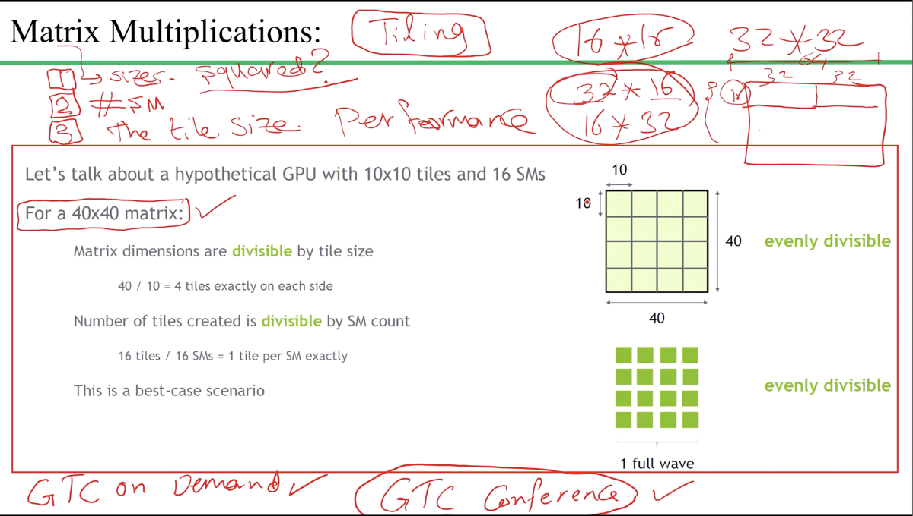
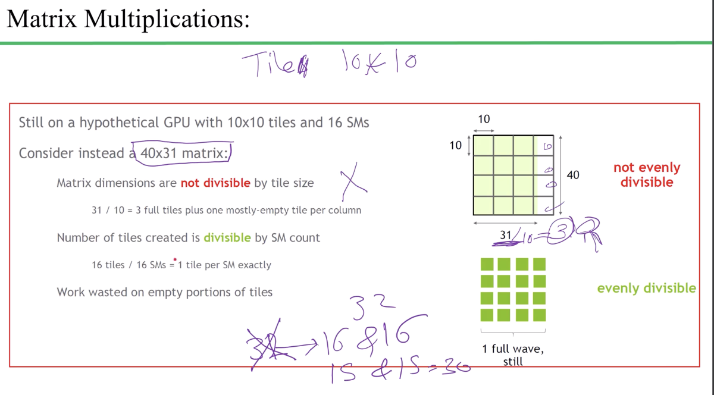

# 第 48 章 矩阵乘法分块技术

## CUDA GPU并行编程：矩阵乘法中的分块技术

## 引言

在矩阵乘法的GPU优化中，**分块（Tiling）**是提升性能的核心技术。本章将深入探讨如何为矩阵乘法应用选择最佳的分块策略，重点分析矩阵尺寸、SM 数量与分块尺寸三者之间的制约关系，特别是针对非方阵的处理方法。

## 关键参数与约束

在选择分块策略时，必须综合考虑以下三个关键参数：

1. **矩阵尺寸（Matrix Dimensions）**：包括方阵与非方阵。对于非方阵，需在X和Y维度上采用不同的分块尺寸（如 32 × 16），前提是矩阵维度必须是分块尺寸的整数倍。
2. **SM数量（Number of SMs）**：直接决定GPU利用率。若分块总数少于SM数量，部分SM将处于空闲状态；若分块总数不是SM数量的整数倍，最后一轮计算将导致SM资源浪费。
3. **分块尺寸（Tile Size）**：直接影响共享内存占用与执行时间。通常需要通过实验（Profiling）确定最优值，而非盲目选择。

**核心原则**：为了最大化GPU占用率（Occupancy），**总分块数应尽可能为SM数量的整数倍**，且矩阵维度应能被分块尺寸整除。

## 分块策略案例分析

以下案例假设GPU拥有 **16个SM**，旨在说明不同参数组合对性能的影响。

## 案例1：理想方阵分块

- **矩阵尺寸**：40 × 40
- **分块尺寸**：4 × 4
- **分析**：

  > X方向分块数 = (40)/(4) = 10, Y方向分块数 = (40)/(4) = 10

  > 总分块数 = 10 × 10 = 100

  虽然100不是16的倍数，但 100 ÷ 16 = 6 dots4，最后一轮仅有4个分块，利用率尚可。

- **更优解**：若选择分块尺寸使总分块数恰好为16或32等SM倍数，则利用率达到100%。例如，若矩阵为 64 × 64，分块为 16 × 16，总分块数 4 × 4 = 16，完美匹配16个SM。

## 案例2：非方阵与边界填充

- **矩阵尺寸**：31 × N
- **问题**：31无法被常见分块尺寸（如16、32）整除。
- **解决方案**：**零填充（Zero Padding）**。将矩阵扩展至 32 × N，新增列/行补零。这虽引入少量冗余计算，但保证了内存访问的对齐与分块的规整性，整体收益远大于代价。

## 案例3：分块数与SM不匹配

- **矩阵尺寸**：40 × 50，**分块尺寸**：10 × 10
- **分析**：

  > 总分块数 = ((40)/(10)) × ((50)/(10)) = 4 × 5 = 20

  20不是16的倍数。第一轮16个SM满载，第二轮仅剩4个分块，导致12个SM空闲，利用率骤降至25%。

- **教训**：即使矩阵维度可被整除，若总分块数不是SM倍数，仍会造成严重的**尾部效应（Tail Effect）**。

## 案例4：最差场景

1. 41无法被10整除，产生不规则边界块（仅1列有效数据）。
2. 总分块数 4 × 5 = 20，非SM倍数，SM利用率低。

- **矩阵尺寸**：40 × 41，**分块尺寸**：10 × 10
- **问题叠加**：此场景同时存在**内存访问不对齐**与**计算资源浪费**双重问题，应极力避免。

## 非方形分块的灵活性

分块不必是正方形。对于 M × K 与 K × N 的非方阵，可采用矩形分块以适配维度：

- 示例：64 × 32 矩阵，可采用 16 × 8 分块。
- X方向：64 / 16 = 4 块
- Y方向：32 / 8 = 4 块
- 总分块数：4 × 4 = 16，完美匹配16 SM。

**关键**：只要满足“维度可整除”且“总分块数为SM倍数”两个条件，任意矩形分块均为合法且潜在最优的选择。

## 学习资源推荐

建议关注 **NVIDIA GTC (GPU Technology Conference)**大会。该会议每年3月举办，涵盖科学计算、AI、大模型、Omniverse及光线追踪等数百场专题讲座。可通过搜索引擎访问**GTC On-Demand**平台，免费注册后即可观看历年讲座文章与资料，是深入学习GPU并行编程的权威资源。

## 总结与展望

本章明确了分块策略选择的黄金法则：

**最优分块** ⟺ 

矩阵维度 mod 分块尺寸 = 0

总分块数 mod SM数量 = 0

下一章将转向 **Tensor Cores（张量核心）**。在Ampere及更新架构中，Tensor Core 执行矩阵乘法的性能可达普通 CUDA Core 的**9倍以上**，已成为现代深度学习与高性能计算中GEMM操作的唯一推荐路径。理解普通核心的分块原理，是掌握 Tensor Core 编程的重要基础。
