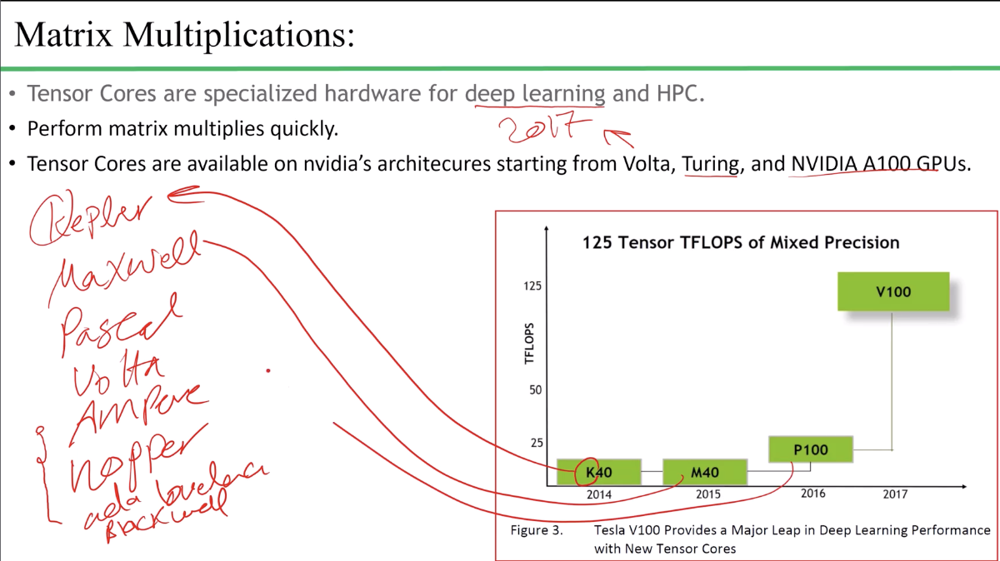
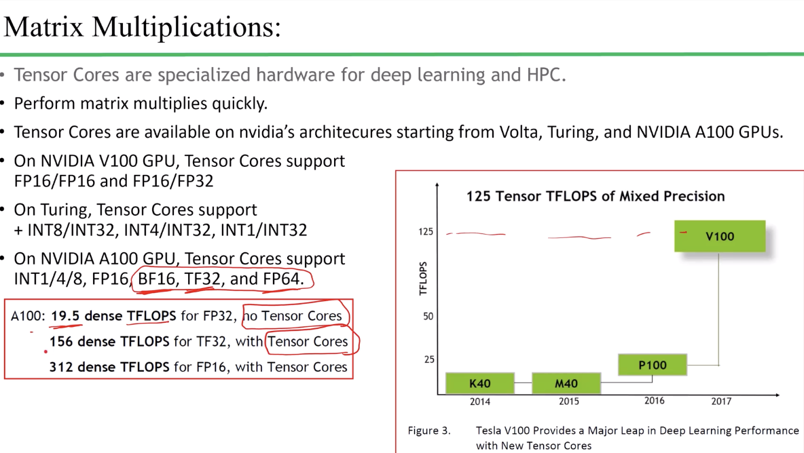
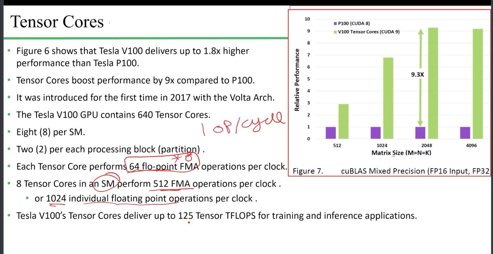
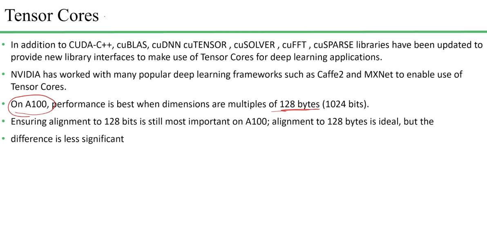

# 第 49 章 张量核心技术详解

## CUDA GPU并行编程：张量核心（Tensor Core）技术详解

## 引言：张量核心的重要性

本章将深入讨论**张量核心（Tensor Core）**。张量核心是当今 NVIDIA GPU 中最核心的计算单元。自 2017 年首次被引入NVIDIA GPU以来，它已被广泛应用于深度学习、广义机器学习乃至科学计算等领域。其核心原因在于：张量核心是专为加速**矩阵乘法**而设计的专用硬件单元。

深度学习极度依赖矩阵乘法运算。正如本系列首章所述，神经网络（例如卷积神经网络）的本质就是矩阵运算。以卷积神经网络为例，输入图像被表示为矩阵，滤波器（Filter）本身也是矩阵，通过将滤波器与图像矩阵相乘来实现特征提取。因此，我们需要一个专门用于加速矩阵乘法的硬件单元，这就是张量核心存在的意义。值得一提的是，AMD GPU 中对应的单元称为**矩阵核心（Matrix Core）**，其功能与张量核心完全相同。

## 张量核心的架构演进与性能飞跃

张量核心是专为深度学习和高性能计算（HPC）设计的专用硬件，能够快速执行混合精度矩阵乘法。它最早出现在 2017年发布的 **Volta** 架构中，随后历经 Turing、Ampere、Hopper、Ada Lovelace 以及最新的 Blackwell 等架构迭代。

## 代际性能对比

图1展示了不同架构 GPU 的性能差异（单位：TFLOPS）。从 Kepler、Maxwell、Pascal 到Volta，性能出现了质的飞跃：

- **Pascal (P100)**：仅配备普通 CUDA 核心，峰值性能约为 15 TFLOPS。
- **Volta (V100)**：首次引入张量核心，峰值性能跃升至约 125 TFLOPS。

相比 Pascal，Volta 在使用张量核心时实现了约 **9倍**的性能提升。这种巨大提升源于张量核心的特殊设计：每个张量核心内部由多个子单元组成，使其每个时钟周期可执行 64次融合乘加（FMA）运算，而普通 CUDA 核心每周期仅能执行 1 次运算。

## 数据类型与精度支持

不同架构的张量核心支持的数据类型逐步丰富：

- **INT1**：适用于二值神经网络（Binary Neural Network），输入为 1-bit，输出至少为 4-bit 或 8-bit（因为累加结果无法用 1-bit 表示）。
- **BF16 与 TF32**：新增 BFloat16 和 TensorFloat-32 格式，兼顾训练稳定性与计算速度。
- **FP64**：支持双精度张量运算，拓展了科学计算应用场景。

- **Volta 架构**：支持 FP16 × FP16 → FP16 以及 FP16 × FP16 → FP32。当输入矩阵数值较大时，为避免累加溢出，通常选择 FP32 作为输出精度。
- **Turing 架构**：在 Volta 基础上增加了整数支持，包括 INT8 × INT8 → INT32 等格式。
- **Ampere 架构**：进一步扩展了数据类型。

以 Ampere (A100) 为例，使用普通核心时性能约为 19--20 TFLOPS，而启用张量核心后，根据数据类型不同，性能可达 156 至 312 TFLOPS。

## 软件生态与编程接口

硬件的革新推动了软件栈的全面更新。NVIDIA 对以下核心库进行了升级以支持张量核心：

- **cuBLAS**：基础线性代数库
- **cuDNN**：深度学习原语库
- **cuSPARSE**：稀疏矩阵运算库
- **cuFFT**：快速傅里叶变换库
- **NCCL**：多GPU通信库

主流深度学习框架（如 PyTorch、TensorFlow、Caffe2、MXNet）均已在后端集成张量核心支持。用户在GPU 上执行矩阵乘法时，框架会自动调用张量核心，无需手动干预。

## 课程预告：实测与编程实践

在下一章中，我们将从理论转向实践：

- **WMMA API**（Warp Matrix Multiply-Accumulate）：底层 Warp 级矩阵运算接口。
- **cuBLAS / cuDNN**：高层库函数接口。

1. **性能实测**：对比相同尺寸矩阵乘法在普通核心与张量核心上的实际执行时间，验证理论性能差距。
2. **编程方法**：介绍两种使用张量核心的编程方式：
3. **对齐要求**：讨论矩阵维度对齐（如 128 字节倍数）对张量核心性能的影响。
