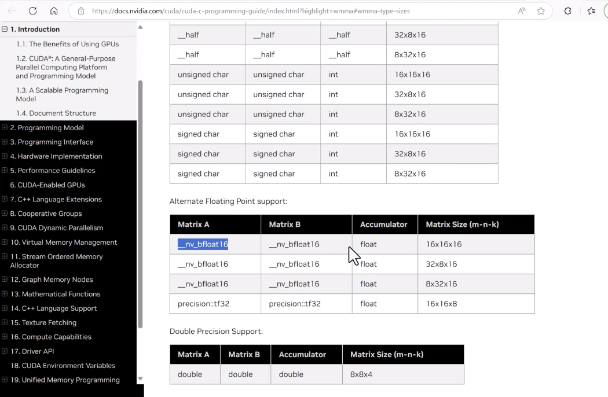
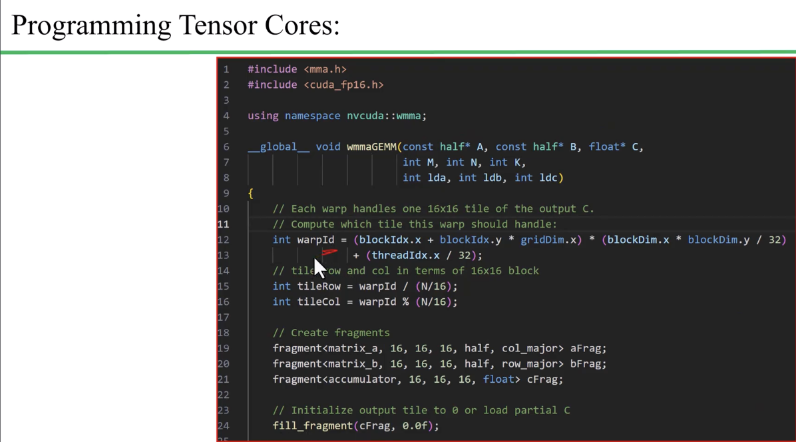

# 第 51 章 WMMA API 编程

## CUDA GPU并行编程：使用WMMA API编程张量核心

## 引言

本章将深入讲解专用于张量核心（Tensor Cores）编程的 **WMMA API**（Warp Matrix Multiply-Accumulate）。在正式介绍API之前，我们首先回顾GPU执行矩阵乘法的四个通用步骤，以便理解WMMA如何映射到这些基础操作中。

## 矩阵乘法的核心步骤回顾

无论是使用普通CUDA核心还是张量核心，矩阵乘法内核均遵循以下四个阶段：

1. **分块（Tiling/Partitioning）**：根据矩阵维度N和块大小（Block Size）计算网格与线程块的划分。
2. **加载（Loading）**：将子矩阵A和B从全局内存加载至共享内存（Shared Memory），以减少访存延迟。注意：输出矩阵C通常不需要预加载，除非进行累加操作。
3. **计算（Execution）**：执行乘加运算。在传统实现中，结果暂存于寄存器变量（如 `sum`）中；在WMMA中，则存储于寄存器碎片（Register Fragments）中。
4. **存储（Storing）**：将寄存器中的最终结果写回全局内存中的矩阵C。

<a id="fig-ch51-1"></a>



## WMMA API 核心概念

## 定义与适用架构

WMMA 全称为 **Warp Synchronous Matrix Multiply-Accumulate**。与普通CUDA核心以线程块（Thread Block）为调度单位不同，WMMA是以 **Warp（线程束）** 为基本执行单元的矩阵运算接口。

- **硬件要求**：仅适用于计算能力（Compute Capability）≥ 7.0 的设备。
- **架构背景**：张量核心首次引入于2017年的 Volta 架构（CC 7.x）。后续的 Turing、Ampere、Hopper 等架构均支持并扩展了该特性。Volta 之前的架构因缺乏物理张量核心，无法使用此API。

## 碎片（Fragments）与数据布局

WMMA 引入了“碎片”（Fragment）的概念，即分布在 Warp 内32个线程寄存器中的矩阵子块。

<a id="fig-ch51-2"></a>



## 支持的维度与类型

WMMA 不支持任意尺寸的分块，必须使用预定义的形状。常见组合包括：

- 16 × 16 × 16
- 32 × 8 × 16 / 8 × 32 × 16
- 数据类型组合需严格遵循官方文档表格（例如：输入FP16 + 累加器FP32，或输入FP16 + 累加器FP16）。
- 支持的新类型包括 BF16、TF32、INT8 等，其中 TF32 具有与 FP32 相同的动态范围但精度较低（10位尾数）。

## 内存布局：行主序 vs 列主序

- **Row-Major**：按行连续存储。
- **Col-Major**：按列连续存储。

**优化提示**：为最大化内存合并访问效率，通常建议矩阵A使用 Col-Major（便于按列加载），矩阵B使用Row-Major（便于按行加载），具体取决于内核的遍历策略。错误的布局会导致非合并访问，显著增加缓存未命中率和内存请求次数。

## WMMA 关键指令

```cpp
// 1. 声明碎片
wmma::fragment<wmma::matrix_a, M, N, K, half, wmma::col_major> frag_a;
wmma::fragment<wmma::matrix_b, M, N, K, half, wmma::row_major> frag_b;
wmma::fragment<wmma::accumulator, M, N, K, float> frag_c;

// 2. 初始化累加器
wmma::fill_fragment(frag_c, 0.0f);

// 3. 从全局/共享内存加载到寄存器碎片
wmma::load_matrix_sync(frag_a, ptr_a, lda);
wmma::load_matrix_sync(frag_b, ptr_b, ldb);

// 4. 执行矩阵乘加: D = A * B + Cwmma::mma_sync(frag_c, frag_a, frag_b, frag_c);

// 5. 将结果存回内存
wmma::store_matrix_sync(ptr_c, frag_c, ldc, wmma::mem_row_major);
```

## Warp ID 的计算方法

CUDA 提供了 `threadIdx` 和`blockIdx`，但**没有**预定义的 `warpId` 变量。在使用 WMMA 时，必须手动计算当前线程所属的 Warp ID。

## 一维网格/线程块

若线程块为一维组织，Warp ID 计算公式为：

> warpId = (threadIdx.x)/(32) + ((blockDim.x)/(32) ) ×blockIdx.x

**解析**：

- threadIdx.x / 32：计算块内 Warp 偏移（整数除法）。
- (blockDim.x / 32) × blockIdx.x：计算当前块之前所有块包含的 Warp 总数。

## 二维网格扩展

对于二维网格，需先将二维 blockIdx 展平为一维线性索引：

> linearBlockId = blockIdx.y ×gridDim.x + blockIdx.x

随后代入上述公式即可。注意：Warp 的划分始终基于线程的线性索引，与网格维度无关。

## WMMA 矩阵乘法执行流程

结合 Warp ID 计算，完整的 WMMA GEMM 内核逻辑如下：

- 计算子矩阵 A 和 B 在当前 K 步的指针偏移。偏移量依赖于 `Leading Dimension (LDA/LDB)` 而非简单的矩阵宽度 N。
- 使用 `load_matrix_sync` 加载数据到寄存器碎片。
- 调用 `mma_sync` 执行乘加运算。

1. **计算 Warp 坐标**：根据 `warpId` 确定当前 Warp 负责处理的全局矩阵分块位置（Row, Col）。
2. **初始化**：使用 `fill_fragment` 将累加器碎片置零。
3. **K维循环**：沿 K 维度以步长16（或其他碎片K维度）遍历：
4. **写回结果**：循环结束后，使用 `store_matrix_sync` 将累加器碎片写入全局内存矩阵 C。

## 重要提示

- **Leading Dimension (LD)**：在计算内存偏移时，务必使用 LD 参数（通常为矩阵的实际分配行数/列数），而非逻辑维度。这是避免内存越界和数据错位的关键。
- **文档查阅**：WMMA 对数据类型、布局和尺寸的组合有严格限制。开发时请务必查阅 CUDA Programming Guide 中的 "Warp Matrix Functions" 章节，确认所用组合受硬件支持。
- **性能调优**：WMMA 仅是基础原语。实际高性能实现还需结合共享内存分块、向量化加载、流水线重叠等优化技术。
