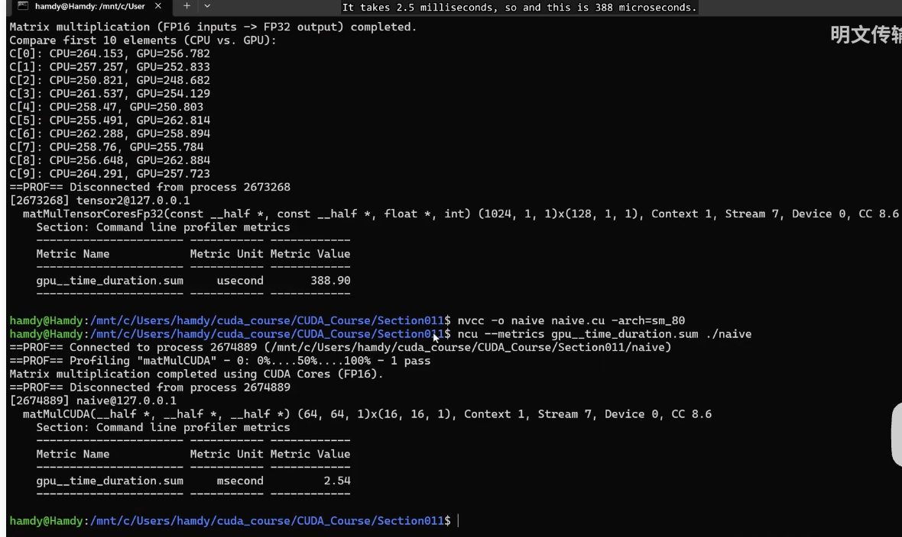

# 第 52 章 WMMA API 实战案例

## CUDA GPU并行编程：WMMA API实战案例

## 概述

本章节详细讲解如何使用 **WMMA (Warp Matrix Multiply-Accumulate) API** 对 NVIDIA GPU 的张量核心（Tensor Cores）进行编程。我们将通过一个 1024× 1024 方阵乘法的实际案例，演示从核函数编写、编译配置到性能对比的完整流程。

## 核函数实现细节

```cpp
#include <cstdio>
#include <cstdlib>
#include <cuda_fp16.h>
#include <mma.h>
#include <iostream>

using namespace nvcuda::wmma;

// Define matrix dimension N (must be multiple of 16)
#ifndef N
#define N 1024
#endif

// We will use 16×16 WMMA tiles
#define TILE_SIZE 16

// Kernel: half-precision inputs, float accumulation/output
//  1D block of 128 threads => 4 warps per block
//  Each warp computes one 16×16 tile in the output
__global__ void matMulTensorCoresFp32(const half* A, const half* B, float* C, int n)
{
    // warpsPerBlock = 4 if blockDim.x=128
    int warpsPerBlock = blockDim.x / 32;
    // global warp ID
    int warpId = blockIdx.x * warpsPerBlock + (threadIdx.x / 32);

    int tilesPerDim = n / TILE_SIZE;               // e.g. N=256 => 16
    int tileCount   = tilesPerDim * tilesPerDim;   // e.g. 16*16=256

    if (warpId >= tileCount) return;

    // Identify which 16×16 tile we're responsible for
    int tileRow = warpId / tilesPerDim;
    int tileCol = warpId % tilesPerDim;

    // Create WMMA fragments
    // matrix_a uses half in col_major
    fragment<matrix_a, TILE_SIZE, TILE_SIZE, TILE_SIZE, half, col_major> aFrag;
    // matrix_b uses half in row_major
    fragment<matrix_b, TILE_SIZE, TILE_SIZE, TILE_SIZE, half, row_major> bFrag;
    // accumulator uses float
    fragment<accumulator, TILE_SIZE, TILE_SIZE, TILE_SIZE, float> cFrag;

    // Initialize accumulator to 0.f
    fill_fragment(cFrag, 0.0f);

    // Loop over the K dimension in steps of 16
    for (int k0 = 0; k0 < n; k0 += TILE_SIZE)
    {
        const half* Ablock = A + (tileRow * TILE_SIZE * n) + k0;
        const half* Bblock = B + (k0 * n) + (tileCol * TILE_SIZE);

        load_matrix_sync(aFrag, Ablock, n);
        load_matrix_sync(bFrag, Bblock, n);

        // Multiply-accumulate
        mma_sync(cFrag, aFrag, bFrag, cFrag);
    }

    // Write the 16×16 tile of results to the float matrix C
    float* Csub = C + (tileRow * TILE_SIZE * n) + (tileCol * TILE_SIZE);
    store_matrix_sync(Csub, cFrag, n, mem_row_major);
}


// Simple helper: fill a half-precision matrix with random values [0..1]
void randomMatrix(half *mat, int size) {
    for (int i = 0; i < size; i++) {
        float r = static_cast<float>(rand()) / RAND_MAX;
        mat[i] = __float2half(r);
    }
}

// CPU reference multiply, but store result in float
//   C[i,j] = sum_{k} ( float(A[i,k]) * float(B[k,j]) )
void cpuMultiplyHalfFloat(const half* A, const half* B, float* C, int n) {
    for (int i = 0; i < n; i++) {
        for (int j = 0; j < n; j++) {
            float sum = 0.0f;
            for (int k = 0; k < n; k++) {
                float aVal = __half2float(A[i * n + k]);
                float bVal = __half2float(B[k * n + j]);
                sum += aVal * bVal;
            }
            C[i * n + j] = sum;
        }
    }
}


int main()
{
    // N must be multiple of 16
    if (N % TILE_SIZE != 0) {
        std::cerr << "Error: N must be a multiple of 16.\n";
        return 1;
    }

    srand(0);

    // Host memory: half inputs, float output
    size_t totalElements = N * N;
    size_t bytesAorB     = totalElements * sizeof(half);
    size_t bytesC        = totalElements * sizeof(float);

    half*  h_A = (half*) malloc(bytesAorB);
    half*  h_B = (half*) malloc(bytesAorB);
    float* h_C = (float*) malloc(bytesC);    // GPU result
    float* h_Ccpu = (float*) malloc(bytesC); // CPU reference

    // Random initialization of A, B in half
    randomMatrix(h_A, N * N);
    randomMatrix(h_B, N * N);

    // Allocate device memory
    half*  d_A = nullptr;
    half*  d_B = nullptr;
    float* d_C = nullptr;
    cudaMalloc(&d_A, bytesAorB);
    cudaMalloc(&d_B, bytesAorB);
    cudaMalloc(&d_C, bytesC);

    // Copy A, B to device
    cudaMemcpy(d_A, h_A, bytesAorB, cudaMemcpyHostToDevice);
    cudaMemcpy(d_B, h_B, bytesAorB, cudaMemcpyHostToDevice);
    cudaMemset(d_C, 0, bytesC);

    // Compute grid/block configuration
    //  - 128 threads => 4 warps per block
    //  - total 16×16 tiles = (N/16)*(N/16)
    //  - each block handles 4 tiles
    int tilesPerDim  = N / TILE_SIZE;
    int tileCount    = tilesPerDim * tilesPerDim;
    int warpsPerBlk  = 128 / 32;  // 4
    int blocksNeeded = (tileCount + warpsPerBlk - 1) / warpsPerBlk;

    dim3 blockSize(128);
    dim3 gridSize(blocksNeeded);

    // Launch kernel
    matMulTensorCoresFp32<<<gridSize, blockSize>>>(d_A, d_B, d_C, N);
    cudaDeviceSynchronize();

    // Copy result back to host
    cudaMemcpy(h_C, d_C, bytesC, cudaMemcpyDeviceToHost);

    // CPU reference multiply (in float)
    cpuMultiplyHalfFloat(h_A, h_B, h_Ccpu, N);

    // Compare first 10 elements
    std::cout << "Matrix multiplication (FP16 inputs -> FP32 output) completed.\n";
    std::cout << "Compare first 10 elements (CPU vs. GPU):\n";
    for (int i = 0; i < 10; i++) {
        float cpuVal = h_Ccpu[i];
        float gpuVal = h_C[i];
        std::cout << "C[" << i << "]: CPU=" << cpuVal
                  << ", GPU=" << gpuVal << std::endl;
    }

    // Cleanup
    cudaFree(d_A);
    cudaFree(d_B);
    cudaFree(d_C);
    free(h_A);
    free(h_B);
    free(h_C);
    free(h_Ccpu);

    return 0;
}
```

## 基本参数与Warp划分

在本案例中，矩阵 A、B、C 的尺寸均为 N=1024，分块尺寸（Tile Size）设为16。核函数定义为 `matrixMultiplyFP32`，输出为单精度浮点数（FP32），输入为半精度浮点数（FP16）。

Warp ID 的获取与大矩阵的分块映射逻辑如下：

- 将矩阵维度 N 除以 Tile Size 得到每个维度的分块数。
- 确保参与计算的 Warp 总数等于 Tile 总数。若不相等，需提前返回以避免越界访问或段错误（Segmentation Fault）。
- Fragment 初始化：将累加器 Fragment C 填充为零。

## 数据加载与计算流程

1. **初始化**：使用 `randomMatrix` 函数生成随机矩阵 A 和 B。
2. **内存分配**：在主机端（Host）和设备端（Device）分别分配指针 `hA, hB, hC` 与 `dA, dB, dC`。
3. **数据传输**：使用 `cudaMemcpy` 将数据从主机拷贝至设备；使用 `cudaMemset` 将设备端矩阵 C 初始化为零。
4. **执行计算**：加载 Fragment A 和 B，调用 WMMA API 执行矩阵乘法，并将结果存储回全局内存中的矩阵 C。

## 主机端验证与同步

- **尺寸校验**：必须确保 N 是 Tile Size 的整数倍（例如 Tile=16 时，N 不能为 15）。
- **同步机制**：调用 `cudaDeviceSynchronize()` 确保 CPU 等待 GPU 核函数执行完毕后再进行后续操作。
- **结果验证**：实现一个 CPU 版本的朴素矩阵乘法，对比 GPU 输出的前 10 个元素以验证正确性。

## 编译配置的关键注意事项

## 架构指定（至关重要）

WMMA API 专为张量核心设计，而张量核心首次引入于 **Volta** 架构。若未指定架构，NVCC默认使用较旧的计算能力（如 SM\_52），导致编译报错（提示 `nvcuda::wmma` 未定义）。

**正确编译命令示例（以 RTX 3060 Ti / Ampere 架构为例）：**

```bash
nvcc -o tensor2 tensor2.cu -arch=sm_80
```

**注意**：无论是否使用张量核心，都应始终显式指定目标架构（`-arch=sm_XX`），以充分利用特定硬件的特性与优化。

## 性能分析与对比

## Profiling 工具使用

使用 `ncu` (Nsight Compute) 测量核函数执行时间：

```bash
ncu --metrics sm__cycles_elapsed.avg ./tensor2
```

## 性能对比结果

针对 1024 × 1024 矩阵乘法，实测数据如下：

| 实现版本 | 执行时间 | 相对加速比 |
| --- | --- | --- |
| 朴素版本（Naive） | 2.5 ms (2500 μs) | 1.0x |
| WMMA API（张量核心） | 388 μs | ≈ 6.5x |

<a id="tab-ch52-1"></a>

*表 1 WMMA API 与朴素矩阵乘法性能对比*

<a id="fig-ch52-1"></a>



**结论**：仅通过使用 WMMA API 调用张量核心，相较于无优化的朴素版本，性能提升约 **6.5倍**（节省约 85% 的执行时间）。建议进一步将 WMMA 版本与共享内存优化版本进行对比，以全面评估不同优化策略的收益。

## 总结与展望

本章完整展示了 WMMA API 的基本用法及编译要求。张量核心编程不仅适用于矩阵乘法，还可扩展至cuBLAS、cuDNN 等库的底层加速。掌握架构感知的编译习惯与性能度量方法，是进行高效 GPU 并行编程的基础。
